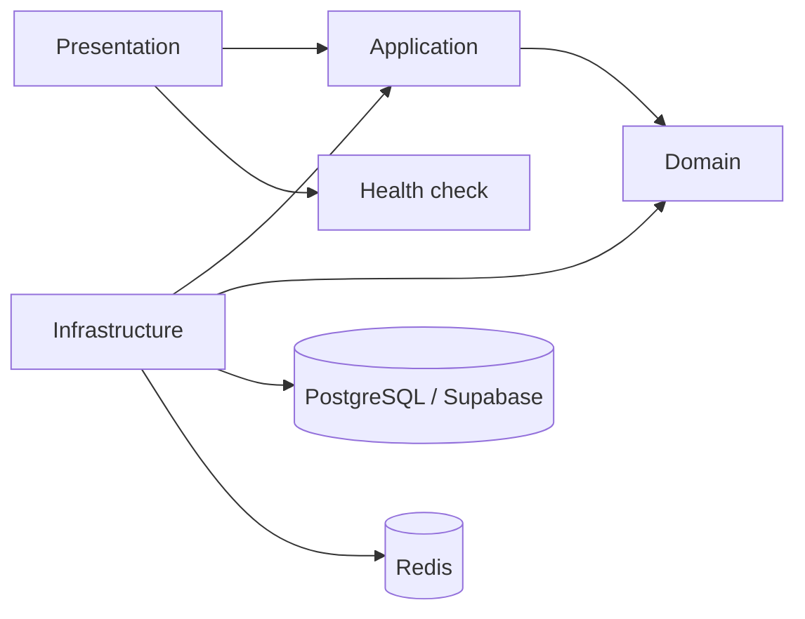

# GODT Backend

Base técnica del backend de GODT Regional 3. Este entregable cubre la
infraestructura local, Sprint 1 y el flujo técnico de gestión documental/OCR
de Sprint 2. No declara homologación clínica, jurídica o institucional.
## Referencias documentales oficiales

Los documentos de referencia del sistema GODT Regional 3
se encuentran en:

`docs/documentos-reales/`

Estos archivos constituyen fuentes de análisis para el motor
documental y las plantillas dinámicas.

Antes de modificar definiciones, formularios o generación PDF,
el agente debe consultar los documentos disponibles.

No debe asumir que el catálogo es definitivo ni codificar
una cantidad fija de documentos.

Las plantillas publicadas y sus versiones deben administrarse
mediante el motor documental del backend.

Los archivos de referencia no sustituyen las versiones
publicadas y homologadas dentro del sistema.
## Diagnóstico y alcance de Sprint 0

El modelo relacional se documenta en
[`docs/data-model-validation.md`](./docs/data-model-validation.md). La fuente
revisada declara 12 tablas conectadas, pero agrupa dos pares; el modelo físico
implementado contiene las 14 entidades requeridas. No se inventan catálogos
clínicos o jurídicos no presentes en la fuente. La conexión Prisma queda
preparada para PostgreSQL local o para una URL de PostgreSQL gestionada por
Supabase; no se incluye una `service_role_key` ni se expone ningún secreto.

La arquitectura prevista es un monolito modular con dependencias dirigidas
hacia el dominio:



La estructura inicial separa `src/health` como superficie de presentación y
aplicación mínima y `src/infrastructure/prisma` como adaptador de persistencia.
El modelo relacional validado y sus diferencias documentales se describen en
[`docs/data-model-validation.md`](./docs/data-model-validation.md).

## Requisitos

- Node.js LTS (22 recomendado)
- Docker Desktop con Compose v2

## Configuración local

1. Copiar `.env.docker.example` a `.env.docker` y cambiar las contraseñas locales.
2. Copiar `.env.example` a `.env`.
3. Levantar PostgreSQL, Redis y pgAdmin:

   ```powershell
   docker compose --env-file .env.docker up -d
   ```

4. Instalar dependencias y generar el cliente Prisma:

   ```powershell
   npm install
   npm run prisma:generate
   ```

5. Validar y aplicar las migraciones:

   ```powershell
   npm run prisma:validate
   npm run prisma:deploy
   ```

6. Iniciar NestJS:

   ```powershell
   npm run start:dev
   ```

Los documentos se guardan en `DOCUMENT_STORAGE_PATH` (privado y excluido de
Git). Redis debe estar disponible para que el worker BullMQ procese OCR.

El health check estará disponible en `http://localhost:3000/health` y Swagger
en `http://localhost:3000/docs`.

## Servicios

| Servicio | URL/host | Persistencia |
|---|---|---|
| PostgreSQL | `localhost:5432` | `godt-postgres-data` |
| Redis | `localhost:6379` | `godt-redis-data` |
| pgAdmin | `http://localhost:5050` | `godt-pgadmin-data` |

En pgAdmin, registrar PostgreSQL con host `postgres`, puerto `5432`, usuario y
contraseña definidos en `.env.docker`.

## Mantenimiento de datos

Detener contenedores sin borrar datos:

```powershell
docker compose stop
docker compose start
```

Eliminar contenedores conservando volúmenes:

```powershell
docker compose down
```

Respaldar y restaurar PostgreSQL:

```powershell
docker compose exec -T postgres pg_dump -U godt -d godt > .\backups\godt.sql
Get-Content .\backups\godt.sql | docker compose exec -T postgres psql -U godt -d godt
```

Para reconstruir imágenes y conservar datos:

```powershell
docker compose down
docker compose pull
docker compose build --no-cache
docker compose --env-file .env.docker up -d
```

No usar `docker compose down -v` como operación habitual: elimina los datos
locales persistidos.

## Validación

```powershell
npm test
npm run test:integration
npm run build
npm run lint
npm run format:check
npm run prisma:validate
npm audit
```

La prueba de integración requiere PostgreSQL activo y se ejecuta explícitamente:

```powershell
$env:RUN_INTEGRATION_TESTS="true"
npm run test:integration
```

## Evidencia de validación

Validado localmente:

- PostgreSQL 17.6: contenedor `healthy`, conexión aceptada y datos conservados
  después de `docker compose restart`.
- Redis 7.4: contenedor `healthy`, `PONG` y datos conservados después del
  reinicio.
- pgAdmin 4: contenedor activo en `http://localhost:5050`.
- Prisma: el esquema y las migraciones versionadas deben validarse contra
  PostgreSQL activo con `npx prisma migrate status`; en esta sesión ese
  servicio no estaba disponible.
- NestJS: `GET /health` respondió `status=ok`, `database=up` y `redis=up`.
- Swagger: `GET /docs` respondió HTTP 200.
- Jest, Build y Prettier: correctos en la validación del Sprint 05. Las
  pruebas de integración requieren PostgreSQL activo y no se declaran
  ejecutadas cuando el servicio no está disponible.
- `npm audit fix` fue ejecutado sin `--force`. Permanecen vulnerabilidades
  transitivas en Jest/CLI/Prisma y vulnerabilidades de runtime asociadas a
  Multer, `js-yaml` y Prisma; sus correcciones disponibles requieren cambios
  mayores o aún no tienen una actualización compatible con NestJS 11/Prisma 6.

Las restricciones de mínimo dos representantes para Anexo 3 y la validación de
metadata de auditoría están implementadas en dominio/aplicación; una FK no
puede garantizar ninguna de ellas. Las reglas jurídicas y la asignación
institucional de usuarios siguen pendientes de homologación.

El estado y las decisiones de Sprint 1 están documentados en
[`docs/sprint-1.md`](./docs/sprint-1.md).
El flujo documental y OCR está documentado en
[`docs/sprint-2.md`](./docs/sprint-2.md).
La fundación del catálogo y las instancias documentales está documentada en
[`docs/sprint-3.md`](./docs/sprint-3.md).
Sprint 2 no se declara cerrado: Tesseract todavía no transforma su salida en
candidatos canónicos y el OCR de PDF multipágina requiere un adaptador seguro
de rasterización.
