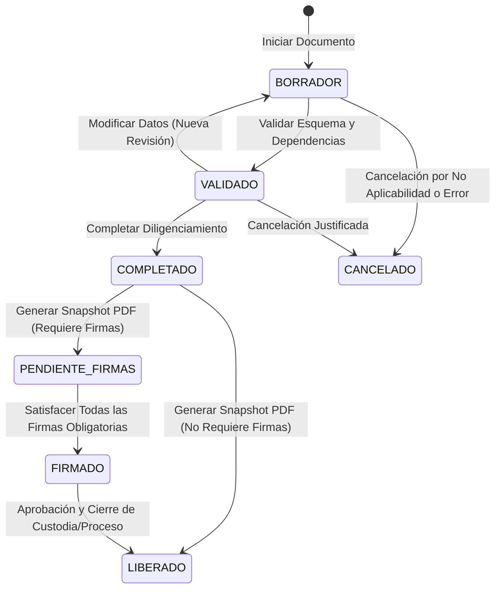

# ADR 005: Ciclo de Vida Documental, Snapshots Inmutables, Renderizado PDF, Participantes y Firmas

## Estado
Aprobado (Fase D) — 2026-11-06

## Contexto
El proceso operativo de donación y trasplante en la Regional 3 requiere que los documentos normativos (Anexos 1 al 9 y sus variantes) completen un ciclo de vida riguroso que garantice fidelidad visual al formato original, trazabilidad del diligenciamiento, asignación de responsables, recolección de firmas o atestaciones y conservación inmutable del archivo PDF final.

Hasta la Fase C.1, los documentos contaban con soporte de borrador (`DRAFT`), revisiones sucesivas (`DocumentResponseRevision`), procedencia (`DocumentFieldProvenance`) y sincronización canónica. Sin embargo, no existía una máquina de estados estricta que controlara la transición hacia estados definitivos (`VALIDADO`, `COMPLETADO`, `PENDIENTE_FIRMAS`, `FIRMADO`, `LIBERADO`), ni un mecanismo para congelar el contenido exacto (snapshot) en el momento de generar el PDF oficial, ni un sistema de firmas vinculado al hash del snapshot.

---

## Decisiones de Arquitectura

### 1. Máquina de Estados del Ciclo de Vida Documental
Se formaliza una máquina de estados determinística para `DocumentInstance` y `ProcessDocument`:

#### Reglas de Transición:
- **`BORRADOR` $\rightarrow$ `VALIDADO`:** Ejecuta validación completa de JSON Schema, reglas condicionales y campos obligatorios.
- **`VALIDADO` $\rightarrow$ `COMPLETADO`:** Verifica que los participantes mínimos configurados estén asignados. Requiere rol `COORDINATOR` o `ADMIN`.
- **`COMPLETADO` $\rightarrow$ `PENDIENTE_FIRMAS` o `LIBERADO`:** Genera el snapshot documental inmutable y el archivo PDF oficial. Si la plantilla exige firmas obligatorias, pasa a `PENDIENTE_FIRMAS`; de lo contrario, pasa directamente a `LIBERADO`.
- **`PENDIENTE_FIRMAS` $\rightarrow$ `FIRMADO`:** Se alcanza automáticamente cuando todos los participantes marcados con `signatureRequired = true` han registrado su firma o atestación sobre el snapshot actual.
- **`FIRMADO` $\rightarrow$ `LIBERADO`:** Validación final del coordinador operativo que sella el documento en el expediente del proceso.
- **Protección Inmutable:** Ningún documento en `COMPLETADO`, `PENDIENTE_FIRMAS`, `FIRMADO` o `LIBERADO` puede ser editado ni sobreescrito. Para corregir información, debe crearse una nueva revisión o documento aclaratorio según la norma clínica.

---

### 2. Snapshots Inmutables (`GeneratedPdfDocument`)
Al completar un documento y solicitar su versión oficial, se genera un snapshot inmutable registrado en `GENERATED_PDF_DOCUMENT` que contiene:
- `processId` e `id` del proceso de donación.
- `documentInstanceId` e `id` de la posición documental.
- `templateVersionId` y hash de la versión de plantilla (`definitionHash`).
- `revisionNumber` exacto del formulario congelado.
- `dataSnapshot`: Objeto JSON inmutable que recopila:
  - Respuestas completas del formulario.
  - Snapshot de procedencia (`DocumentFieldProvenance`).
  - Valores canónicos vigentes en el instante de generación.
  - Mediciones repetibles (`REPEATABLE`) con referencia exacta a su ID de observación, fecha efectiva y contexto de muestra.
  - Usuario generador (`generatedById`) y marca temporal (`createdAt`).
- `sha256Hash`: Hash criptográfico SHA-256 del binario PDF generado.
- `objectStorageKey`: Ruta de almacenamiento en el almacenamiento privado seguro.

**Garantía de Inmutabilidad:** Mutaciones posteriores en el donante (`DonorRecord`), en el diccionario canónico o publicaciones de nuevas plantillas jamás alteran los snapshots históricos ya emitidos.

---

### 3. Arquitectura de Renderizado PDF (`pdf-lib`)
- Se adopta la biblioteca `pdf-lib` por ser 100% TypeScript pura, sin dependencias nativas ni binarios de Chromium.
- Renderizado fiel a los formatos originales:
  - Márgenes, tipografía institucional, tamaños de página estándar (Letter/A4).
  - Encabezados institucionales oficiales de la Regional 3.
  - Tablas dinámicas con bordes claros y control estricto de paginación para evitar desbordamientos de celdas.
  - Cajas de firmas reservadas al pie del documento.
- Formatos piloto prioritarios:
  - **Anexo 1:** Valoración y alerta de donante (datos clínicos, donante, laboratorio).
  - **Anexo 6:** Acta general de rescate/extracción (tablas complejas de órganos, equipos quirúrgicos, soluciones y tejidos).
  - **Anexo 8:** Cadena de custodia (secuencia histórica de eventos de transporte y recepción).
  - **Anexo 7:** Fichas quirúrgicas especializadas por órgano y actas de rescate de tejido.

---

### 4. Participantes Documentales y Sistema de Firmas Desacoplado
- **`DocumentParticipant`:** Modela la relación específica entre una persona (usuario del sistema o participante externo de `ProcessParticipant`) y un documento concreto. Declara su rol en ese anexo (`signerRole`), si su firma es obligatoria (`signatureRequired`) y el orden de firma (`signatureOrder`).
- **`DocumentSignature`:** Registro inmutable de la firma o atestación vinculado específicamente a un snapshot (`generatedPdfId`) y a su hash SHA-256 (`snapshotHash`).
  - Tipos de firma:
    - `ATESTACION_USUARIO`: Atestación con credenciales del usuario autenticado en el sistema.
    - `MANUSCRITA_PRESENCIAL`: Constancia presencial con testigo o coordinador.
    - `DIBUJADA_UI`: Firma capturada visualmente en pantalla táctil/firma digitalizada.
    - `DIGITAL_CERTIFICADA`: Firma PKI con token criptográfico (pendiente de proveedor).
  - Regla: La firma es indivisible del hash del PDF. Si se generase un nuevo snapshot documental, las firmas previas no son transferibles y deben recabarse nuevamente.

---

### 5. Cadena de Custodia (Anexo 8)
- El Anexo 8 no se modela como una tabla estática sobreescrita.
- Se implementa el modelo `CustodyEvent` como una secuencia append-only cronológica:
  - Cada evento posee: `sequenceNumber`, `eventType` (`RECOLECCION`, `TRANSPORTE`, `ENTREGA`, `RECEPCION`, `DISPOSICION`), descripción del ítem, código de contenedor, precinto/sello, temperatura (°C), datos completos del entregante y receptor, fecha/hora y verificación de integridad.
  - Prohibición de modificación o eliminación de eslabones previos; cualquier rectificación se realiza mediante un nuevo evento secuencial con observaciones.
