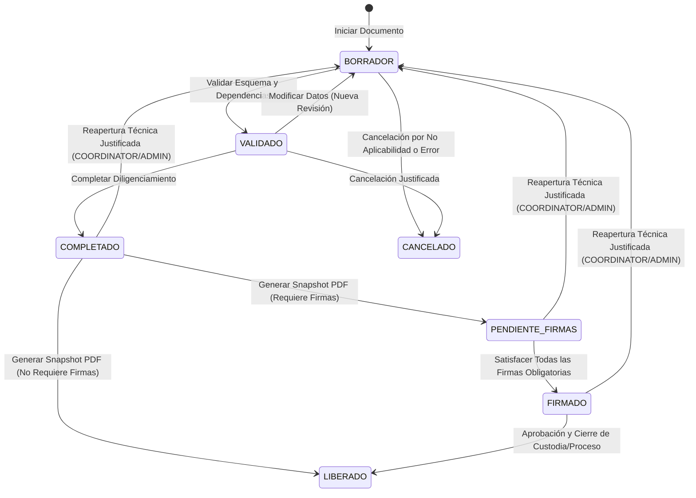

# ADR 005: Ciclo de Vida Documental, Snapshots Inmutables, Renderizado PDF, Participantes, Firmas y Cadena de Custodia

## Estado
Aprobado con adenda correctiva (Fase D.1 — Auditoría Correctiva de Integridad Documental) — 2026-11-06

## Contexto
El proceso operativo de donación y trasplante en la Regional 3 requiere que los documentos normativos (Anexos 1 al 9 y sus variantes) completen un ciclo de vida riguroso que garantice fidelidad visual al formato original, trazabilidad del diligenciamiento, asignación de responsables, recolección de firmas o atestaciones y conservación inmutable del archivo PDF final.

Hasta la Fase C.1, los documentos contaban con soporte de borrador (`DRAFT`), revisiones sucesivas (`DocumentResponseRevision`), procedencia (`DocumentFieldProvenance`) y sincronización canónica. Sin embargo, no existía una máquina de estados estricta que controlara la transición hacia estados definitivos (`VALIDADO`, `COMPLETADO`, `PENDIENTE_FIRMAS`, `FIRMADO`, `LIBERADO`), ni un mecanismo para congelar el contenido exacto (snapshot) en el momento de generar el PDF oficial, ni un sistema de firmas vinculado al hash del snapshot.

En la Fase D.1 se realizó una auditoría correctiva para resolver hallazgos críticos de integridad:
1. Reconciliación estricta del inventario de 23 posiciones con los archivos originales en `docs/documentos-reales/` (clarificación de la Posición 13 como `ANEXO_7_OTROS_ORGANOS` y mantenimiento de las posiciones 20 a 23 como `POSICIÓN RESERVADA`).
2. Delimitación jurídica de firmas conforme a la Ley 527 de 1999 y Decreto 2364 de 2012 de Colombia.
3. Desacoplamiento criptográfico entre el **Digest de Manifiesto Canónico** y el **Hash Binario del PDF**.
4. Endurecimiento transaccional y reglas de verificación de integridad en la Cadena de Custodia (Anexo 8).
5. Protocolo de reapertura técnica controlada de instancias documentales con invalidación de snapshots previos.

---

## Decisiones de Arquitectura

### 1. Máquina de Estados del Ciclo de Vida Documental
Se formaliza una máquina de estados determinística para `DocumentInstance` y `ProcessDocument`:

#### Reglas de Transición y Reaperturas:
- **`BORRADOR` $\rightarrow$ `VALIDADO`:** Ejecuta validación completa de JSON Schema, reglas condicionales y campos obligatorios.
- **`VALIDADO` $\rightarrow$ `COMPLETADO`:** Verifica que los participantes mínimos configurados estén asignados. Requiere rol `COORDINATOR` o `ADMIN`.
- **`COMPLETADO` $\rightarrow$ `PENDIENTE_FIRMAS` o `LIBERADO`:** Genera el snapshot documental inmutable y el archivo PDF oficial. Si la plantilla exige firmas obligatorias, pasa a `PENDIENTE_FIRMAS`; de lo contrario, pasa directamente a `LIBERADO`.
- **`PENDIENTE_FIRMAS` $\rightarrow$ `FIRMADO`:** Se alcanza automáticamente cuando todos los participantes marcados con `signatureRequired = true` han registrado su firma o atestación sobre el snapshot actual.
- **`FIRMADO` $\rightarrow$ `LIBERADO`:** Validación final del coordinador operativo que sella el documento en el expediente del proceso. **Un documento en estado `LIBERADO` es estrictamente inmutable y bajo ninguna circunstancia puede ser reabierto**.
- **Reapertura Técnica Controlada:** Se permite a roles autorizados (`COORDINATOR` o `ADMIN`) retornar a `BORRADOR` documentos que se encuentren en `COMPLETADO`, `PENDIENTE_FIRMAS` o `FIRMADO`, bajo las siguientes condiciones inexcusables:
  - Justificación obligatoria no vacía ($\ge 10$ caracteres).
  - Marcado de todos los snapshots previos como `SUPERSEDED` para invalidar su vigencia legal y operativa.
  - Conservación histórica de las firmas emitidas previamente con fines de auditoría forense.
  - Emisión de un evento inmutable en el registro de auditoría (`DOCUMENT_INSTANCE_REOPENED`).

---

### 2. Snapshots Inmutables, Desacoplamiento Criptográfico y Congelamiento

Al completar un documento y solicitar su versión oficial, se genera un snapshot inmutable registrado en `GENERATED_PDF_DOCUMENT`.

#### 2.1. Desacoplamiento entre Digest de Manifiesto y Hash Binario del PDF
Para evitar paradojas criptográficas (intentar estampar dentro de un PDF el hash del propio binario resultante que aún no existe):
1. **Digest de Manifiesto Canónico (`snapshotDigest`):**  
   Se calcula mediante SHA-256 a partir del objeto JSON canónico ordenado determinísticamente (`sortKeys`), que incluye las respuestas del documento, los participantes congelados y los metadatos esenciales. Este digest **es inmutable antes del renderizado** y **se estampa visiblemente en el pie de página de cada hoja del PDF** (`Digest de Manifiesto (Contenido): ...`).
2. **Hash Criptográfico Binario (`sha256Hash` / `pdfBinaryHash`):**  
   Se calcula mediante SHA-256 sobre la totalidad de los bytes definitivos del archivo PDF serializado (`pdfDoc.save()`). Se almacena en la columna `sha256Hash` de `GeneratedPdfDocument` y se expone a clientes en los encabezados HTTP `ETag` y `X-Document-SHA256`.

#### 2.2. Congelamiento Histórico de Participantes
El snapshot almacena en `dataSnapshot.participants` la fotografía exacta de los participantes requeridos y sus roles en el instante de la emisión, asegurando que adiciones o remociones posteriores en el proceso no alteren el registro histórico del PDF ya generado.

---

### 3. Arquitectura de Renderizado PDF (`pdf-lib`)
- Se adopta la biblioteca `pdf-lib` por ser 100% TypeScript pura, sin dependencias nativas ni binarios de Chromium.
- Formatos piloto prioritarios:
  - **Anexo 1:** Portrait (612 x 792 pt). Valoración y alerta de donante.
  - **Anexo 6:** Portrait (612 x 792 pt) en 2 páginas. Acta general de rescate/extracción.
  - **Anexo 8:** Landscape apaisado (792 x 612 pt). Formato oficial de Cadena de Custodia con 9 columnas completas de trazabilidad ininterrumpida.
  - **Anexo 7:** Fichas quirúrgicas especializadas por componente anatómico (Ocular, Riñón Derecho, etc.), clarificando taxativamente la Posición 13 como `ANEXO_7_OTROS_ORGANOS`.

---

### 4. Participantes Documentales y Delimitación Jurídica de Firmas (Ley 527 de 1999)

- **`DocumentParticipant`:** Modela la relación específica entre una persona y un documento concreto. Declara su rol en ese anexo (`signerRole`), si su firma es obligatoria (`signatureRequired`) y el orden de firma (`signatureOrder`).
- **`DocumentSignature`:** Registro inmutable de la firma o atestación vinculado específicamente a un snapshot (`generatedPdfId`) y a su hash SHA-256 (`snapshotHash`).
- **Delimitación Jurídica (Ley 527 de 1999 y Decreto 2364 de 2012 de Colombia):**
  - `ATESTACION_USUARIO`: Firma electrónica basada en autenticación robusta y trazabilidad del usuario en sesión activa. Requiere aceptación explícita de declaración de veracidad (`attestationText`) y genera un hash de atestación (`attestationDigest`).
  - `MANUSCRITA_PRESENCIAL`: Constancia de suscripción física ante testigo o coordinador.
  - `DIBUJADA_UI`: Firma digitalizada capturada en pantalla táctil/canvas.
  - `DIGITAL_CERTIFICADA`: **Bloqueada operativamente.** El sistema no permite emitir firmas de este tipo hasta tanto no se cuente con un conector PKI homologado ante una Entidad de Certificación Acreditada por el ONAC (Organismo Nacional de Acreditación de Colombia).
  - **Aclaración Pericial:** La generación de un hash SHA-256 sobre el documento otorga integridad de datos y no repudio informático, pero **NO sustituye una firma digital certificada en los términos del Artículo 28 de la Ley 527 de 1999**.

---

### 5. Cadena de Custodia (Anexo 8) y Reglas de Endurecimiento

El Anexo 8 administra el libro mayor de custodia inmutable mediante la entidad `CustodyEvent`:
1. **Asignación Secuencial Transaccional:** El cálculo de `sequenceNumber` se realiza dentro de una transacción `prisma.$transaction` para prevenir condiciones de carrera en registros concurrentes.
2. **Verificación de Integridad Auditada:**
   - El atributo `integrityVerified` tiene valor por defecto `false`.
   - La verificación de integridad requiere obligatoriamente registrar `verifiedById`, `verifiedAt` y notas de verificación (`verifierNotes`).
3. **Rango Térmico Físico:** Se valida estrictamente que cualquier temperatura registrada se encuentre en el rango biológico y logístico válido: entre **-80.0 °C** (congelación criogénica de tejidos) y **+45.0 °C** (límite ambiental admisible).
4. **Append-Only Estricto:** Prohibición absoluta de modificar o eliminar eventos de custodia registrados. Toda corrección debe registrarse como un nuevo evento de tipo `NOVEDAD` o `VERIFICACION`.

