# GODT Regional 3 — Arquitectura del Proceso de Donación y Motor Documental (v2.0)

## 1. Descripción del Dominio Clínico-Operativo

El sistema **GODT Regional 3** gestiona los procesos operativos de donación y trasplante de órganos y tejidos en la regional.
El modelo evoluciona para situar al **Proceso de Donación (`DonationProcess`)** como la unidad operativa, jurídica y clínica central del sistema, superando la anterior visión centrada exclusivamente en el expediente del donante (`DonorRecord`).

### 1.1 Diferenciación Conceptual Esencial

- **Donante (`DonorRecord`):** Representa el expediente maestro de la persona fallecida o potencial donante (identidad canónica, número de documento, grupo sanguíneo, RH, datos antropométricos y certificación de muerte encefálica como hecho biológico).
- **Proceso de Donación (`DonationProcess`):** Representa la actuación u operativo concreto de rescate y coordinación. Un donante puede tener uno o varios procesos a lo largo del tiempo o una actuación que derive en operativos específicos. El proceso cuenta con:
  - Identificador interno UUID y código visible único (ej. `PROC-2026-0001`).
  - Estado del proceso (`EN_VALORACION`, `EN_CURSO`, `COMPLETADO`, `CANCELADO`, `SUSPENDIDO`).
  - Fechas de apertura y cierre con responsable de apertura (`openedById`).
  - Institución principal (`primaryIpsName`).
  - Instituciones participantes con funciones específicas en el proceso (`ProcessInstitution`).
  - Participantes clínicos, asistenciales, deudos y testigos (`ProcessParticipant`).
  - Paquete documental estructurado de 23 posiciones (`ProcessDocument`).
  - Repositorio canónico de valores compartidos y mediciones temporales (`ProcessCanonicalValue`).
  - Trazabilidad y auditoría inmutable (`AuditEvent`).
- **Separación entre Posiciones de Anexos y Documentos Fuente:**
  - **Posiciones del paquete documental (Anexos):** Los documentos normativos institucionales del proceso de donación (Anexos 1 al 9 con sus variantes de tejidos y órganos). Cada posición se representa mediante `ProcessDocument` y se materializa mediante instancias documentales (`DocumentInstance`).
  - **Documentos fuente (`SourceDocument`):** Historias clínicas hospitalarias, evaluaciones complementarias, exámenes de laboratorio externos, hojas de cálculo de hemodilución y anexos no normativos. Son recursos probatorios cargados al proceso para consulta, archivo confidencial y extracción asistida por OCR. No son plantillas normativas ni se convierten automáticamente en anexos.

---

## 2. Diagrama Entidad-Relación (ER) Actualizado

```mermaid
erDiagram
    DONOR_RECORD ||--o{ DONATION_PROCESS : "origina procesos"
    SYSTEM_USER ||--o{ DONATION_PROCESS : "abre / cierra"
    SYSTEM_USER ||--o{ DOCUMENT_INSTANCE : "crea / actualiza"
    SYSTEM_USER ||--o{ AUDIT_EVENT : "ejecuta"

    DONOR_RECORD ||--o| BRAIN_DEATH_CERTIFICATION : "certificación de muerte encefálica"
    DONOR_RECORD ||--o| DONATION_LEGALIZATION : "legalización histórica"
    DONOR_RECORD ||--o{ SOURCE_DOCUMENT : "fuentes del donante"

    DONATION_PROCESS ||--o{ PROCESS_INSTITUTION : "asocia IPS con roles"
    DONATION_PROCESS ||--o{ PROCESS_PARTICIPANT : "registra participantes"
    DONATION_PROCESS ||--o{ PROCESS_DOCUMENT : "contiene 23 posiciones"
    DONATION_PROCESS ||--o{ PROCESS_CANONICAL_VALUE : "valores canónicos vigentes"
    DONATION_PROCESS ||--o{ PROCESS_CANONICAL_HISTORY : "historial mediciones/revisiones"
    DONATION_PROCESS ||--o{ SOURCE_DOCUMENT : "documentos fuente / HC"
    DONATION_PROCESS ||--o{ DOCUMENT_INSTANCE : "instancias de anexos"
    DONATION_PROCESS ||--o{ ORGAN_RECOVERY_SURGERY : "cirugías del operativo"
    DONATION_PROCESS ||--o{ TISSUE_RECOVERY_PROCEDURE : "rescates de tejidos"

    PROCESS_PACKAGE ||--o{ PROCESS_PACKAGE_VERSION : "versiona paquete"
    DONATION_PROCESS }o--|| PROCESS_PACKAGE_VERSION : "utiliza paquete"

    PROCESS_DOCUMENT }o--|| TEMPLATE_VERSION : "enlaza plantilla oficial (si publicada)"
    PROCESS_DOCUMENT ||--o{ DOCUMENT_INSTANCE : "historial de instancias"
    PROCESS_DOCUMENT ||--o| DOCUMENT_INSTANCE : "instancia vigente (currentInstanceId)"

    DOCUMENT_INSTANCE ||--o{ DOCUMENT_RESPONSE_REVISION : "revisiones append-only"
    DOCUMENT_RESPONSE_REVISION ||--o{ DOCUMENT_FIELD_PROVENANCE : "procedencia de campos"
    DOCUMENT_INSTANCE ||--o{ DOCUMENT_PARTICIPANT_ASSIGNMENT : "asigna participantes al anexo"
    DOCUMENT_INSTANCE ||--o{ DOCUMENT_SIGNATURE_REQUIREMENT : "requisitos de firma declarados"
    DOCUMENT_SIGNATURE_REQUIREMENT ||--o{ DOCUMENT_SIGNATURE_EVENT : "evidencias de firma capturadas"
    DOCUMENT_INSTANCE ||--o{ GENERATED_PDF_DOCUMENT : "PDFs generados auditados"

    PROCESS_PARTICIPANT ||--o{ DOCUMENT_PARTICIPANT_ASSIGNMENT : "participa en"
    PROCESS_PARTICIPANT ||--o{ DOCUMENT_SIGNATURE_EVENT : "firma como"
    SYSTEM_USER ||--o| PROCESS_PARTICIPANT : "vínculo opcional con usuario"

    SOURCE_DOCUMENT ||--o{ OCR_PROCESSING_JOB : "trabajos OCR"
    OCR_PROCESSING_JOB ||--o{ OCR_EXTRACTED_FIELD : "candidatos extraídos"
    OCR_EXTRACTED_FIELD ||--o{ PROCESS_CANONICAL_VALUE : "ratificación humana"
```

---

## 3. Modelo del Diccionario Canónico y Valores Compartidos

### 3.1 Clases de Información y Cardinalidad

El repositorio de marcadores canónicos debe distinguir con precisión:

1. **Campos de valor único vigente (`cardinality: "SINGLE"`):**
   - Conceptos donde solo existe una verdad confirmada en el proceso o donante.
   - Ejemplos: `donor.identity.full_name`, `donor.identity.document_number`, `donor.clinical.blood_group`, `donor.clinical.rh_factor`, `process.originating_ips`.
   - Una actualización de estos campos actualiza el valor vigente y registra una revisión en el historial append-only.
2. **Campos con múltiples observaciones a través del tiempo (`cardinality: "REPEATABLE"`):**
   - Mediciones clínicas, signos vitales, gasometrías, resultados de laboratorio repetidos y administraciones farmacológicas.
   - Ejemplos:
     - `donor.clinical.arterial_ph`: mediciones seriadas en diferentes horas.
     - `donor.clinical.serum_creatinine`: evolución renal seriada.
     - `donor.clinical.vital_signs`: frecuencia cardíaca, TA media, temperatura registradas periódicamente.
     - `donor.clinical.medications`: dosis administradas con fecha y hora.
   - Cada medición constituye una entrada inmutable con su propia marca temporal (`effectiveAt`), contexto de muestra (`sampleContext`, ej. "Gasometría de ingreso", "Control post-inotropo 2") y unidad.

### 3.2 Alcance (`Scope`) y Titularidad de Datos

| Alcance (`Scope`) | Entidad Propietaria | Criterio de Titularidad | Ejemplo |
|---|---|---|---|
| `DONOR` | `DonorRecord` | Datos biológicos, identitarios y antecedentes permanentes del individuo. Persisten más allá de un operativo concreto. | Nombres, documento de identidad, sexo, grupo sanguíneo, antecedentes patológicos, certificación de muerte encefálica. |
| `PROCESS` | `DonationProcess` | Datos circunstanciales del operativo de donación, tiempos quirúrgicos, IPS participantes y mediciones realizadas durante el rescate. | IPS generadora, coordinador asignado, hora de clampeo, gasometrías de mantenimiento, oferta de órganos. |
| `DOCUMENT` | `DocumentInstance` | Respuestas exclusivas de un anexo específico que no tienen sentido fuera de su formato particular. | Observaciones estéticas del formulario, notas del instrumentador, formato específico de acta. |

### 3.3 Estructura de `ProcessCanonicalValue` y `ProcessCanonicalHistory`

- **`ProcessCanonicalValue`:**
  - `id`: UUID
  - `processId`: UUID (FK a `DonationProcess`)
  - `canonicalFieldKey`: string (clave jerárquica)
  - `scope`: `DONOR` | `PROCESS` | `DOCUMENT`
  - `cardinality`: `SINGLE` | `REPEATABLE`
  - `dataType`: `string` | `number` | `boolean` | `date` | `date-time` | `array` | `object`
  - `unit`: string opcional (ej. "mmHg", "c.c.", "mg/dL")
  - `currentValue`: JSONB
  - `effectiveAt`: DateTime (fecha/hora de la medición o registro)
  - `sampleContext`: string opcional (contexto o etiqueta de muestra)
  - `sourceKind`: `MANUAL` | `DONOR_RECORD` | `SOURCE_DOCUMENT` | `OCR_CONFIRMED` | `OCR_MODIFIED` | `CALCULATED`
  - `sourceDocumentId`: UUID opcional
  - `sourceInstanceId`: UUID opcional
  - `sourceRevisionId`: UUID opcional
  - `validatedById`: UUID opcional (FK a `SystemUser`)
  - `validatedAt`: DateTime opcional
  - `version`: entero secuencial (control de concurrencia optimista)
  - `conflictStatus`: `NONE` | `PENDING` | `RESOLVED`
  - `conflictDetails`: JSONB opcional
- **`ProcessCanonicalHistory` (Historial Append-Only):**
  - Registro inmutable de cada creación, modificación o adición de medición, garantizando trazabilidad y reconstrucción cronológica.

---

## 4. Estructura de Paquetes y las 23 Posiciones Documentales

### 4.1 Principio de Declaración del Paquete
El paquete documental se modela mediante:
- `ProcessPackage`: Paquete institucional (ej. `PAQUETE_REGIONAL_3`).
- `ProcessPackageVersion`: Versión inmutable del paquete (ej. `v1.0.0`) que define las 23 posiciones esperadas, sus plantillas enlazadas, obligatoriedad y reglas declarativas de aplicabilidad.
- `ProcessDocument`: Posición documental concreta dentro de un `DonationProcess`.

### 4.2 Reconciliación del Inventario: Anexos vs Documentos Fuente

De los 23 archivos analizados en el inventario institucional, se establece la distinción formal:

**Posiciones Normativas de Anexos (Paquete Operativo):**
1. **Posición 1 — Anexo 1:** Formato de valoración y alerta de posible donante.
2. **Posición 2 — Anexo 2:** Notificación a los deudos / Legalización por presunción legal (Condicionado por mecanismo legal).
3. **Posición 3 — Anexo 3:** Formato consentimiento informado de donación / Legalización familiar (Condicionado por mecanismo legal).
4. **Posición 4 — Anexo 4:** Registro de donante y oferta de órganos y tejidos.
5. **Posición 5 — Anexo 5:** Formato de remisión de muestras para laboratorio e inmunogenética.
6. **Posición 6 — Anexo 6:** Registro general de extracción de órganos y tejidos.
7. **Posición 7 — Anexo 7 (Variante Ocular):** Acta de rescate de tejido ocular.
8. **Posición 8 — Anexo 7 (Variante Cardiovascular):** Acta de rescate de tejido cardiovascular.
9. **Posición 9 — Anexo 7 (Variante Osteomuscular):** Acta de rescate de tejido osteomuscular.
10. **Posición 10 — Anexo 7 (Variante Piel):** Acta de rescate de tejido piel.
11. **Posición 11 — Anexo 7 (Variante Corazón):** Ficha de extracción de corazón (Cardiectomía).
12. **Posición 12 — Anexo 7 (Variante Hígado):** Ficha de extracción de hígado (Hepatectomía).
13. **Posición 13 — Anexo 7 (Variante Otros Órganos):** Ficha de extracción de otros órganos.
14. **Posición 14 — Anexo 7 (Variante Páncreas):** Ficha de extracción de páncreas.
15. **Posición 15 — Anexo 7 (Variante Pulmón):** Ficha de extracción de pulmón (Neumonectomía).
16. **Posición 16 — Anexo 7 (Variante Riñón Derecho):** Ficha de extracción riñón derecho (Nefrectomía).
17. **Posición 17 — Anexo 7 (Variante Riñón Izquierdo):** Ficha de extracción riñón izquierdo (Nefrectomía).
18. **Posición 18 — Anexo 8:** Formato cadena de custodia de elementos materia de prueba y evidencias.
19. **Posición 19 — Anexo 9:** Carta de entrega de cuerpo a INMLCF para procesos médico-legales.

**Documentos Fuente y Soportes Clínicos (Tratados como `SourceDocument` vinculados al proceso):**
- **Cálculo de Hemodilución:** Soporte analítico de hemodilución (cargado como documento fuente o calculado asistido).
- **Evaluación de Riesgo COVID-19 Tissue Bank:** Formulario de cribado epidemiológico (documento fuente).
- **HC Donante Institucional:** Historia clínica hospitalaria del donante (documento fuente confidencial para OCR).
- **Historia Clínica Tissue Bank:** Historia clínica de banco de tejidos (documento fuente confidencial para OCR).

> [!IMPORTANT]
> Si una posición del paquete aún no cuenta con una plantilla oficial aprobada y publicada (`PUBLISHED`), el sistema conserva su posición dentro del paquete en estado de plantilla `PENDING_TEMPLATE` o `DRAFT`, permitiendo al coordinador identificar que la posición existe formalmente en el paquete sin presentarla engañosamente como un formulario oficial homologado.

---

## 5. Modelo de Participantes, Asignaciones y Firmas

### 5.1 Separación de Responsabilidades
Para evitar ambigüedades jurídicas y operativas, se desacoplan 4 conceptos:
1. **Identidad y Rol en el Proceso (`ProcessParticipant`):**
   - Persona que participa en el operativo (nombre, tipo y número de documento, registro profesional, institución a la que pertenece, rol en el proceso: `COORDINADOR_OPERATIVO`, `CIRUJANO_RESCATE`, `MEDICO_CERTIFICADOR`, `TECNICO_TEJIDOS`, `DEUDO`, `REPRESENTANTE_LEGAL`, `TESTIGO`, `CUSTODIO`).
   - Opcionalmente enlazado a `SystemUser` si tiene cuenta en el sistema.
2. **Asignación Documental (`DocumentParticipantAssignment`):**
   - Vinculación de un `ProcessParticipant` a una `DocumentInstance` concreta desempeñando una función documental específica (ej. "Médico Cirujano que certifica nefrectomía en Anexo 7").
3. **Requisito de Firma (`DocumentSignatureRequirement`):**
   - Declaración de los espacios de firma requeridos para una plantilla/revisión:
     - `roleCode`: Rol requerido (ej. `CIRUJANO_RESCATE`).
     - `isMandatory`: boolean.
     - `assignedParticipantId`: UUID opcional del participante asignado.
     - `status`: `PENDING`, `SIGNED`, `REJECTED`, `EXEMPTED`.
4. **Evidencia de Firma (`DocumentSignatureEvent`):**
   - Evidencia concreta e inmutable capturada:
     - `participantId`: UUID del firmante.
     - `roleCode`: rol desempeñado al firmar.
     - `documentInstanceId`: instancia firmada.
     - `revisionNumber`: número de revisión exacto sobre el que se firmó.
     - `signedAt`: fecha y hora exacta.
     - `evidenceType`: `DIGITAL_DRAWING`, `BIOMETRIC`, `ATTESTATION`, `ELECTRONIC_OTP`, `PHYSICAL_UPLOAD`.
     - `evidenceStoragePath`: ruta privada del recurso de firma con su hash SHA-256.
     - `verificationStatus`: `VERIFIED`, `PENDING_VERIFICATION`, `REJECTED`.
     - `signerIp`: IP del firmante.

### 5.2 Política de Bloqueo Documental e Inmutabilidad
- **El registro de una primera firma NO congela automáticamente el documento:** En formularios con múltiples intervinientes (ej. cirujano + ayudante + anestesiólogo), congelar tras la primera firma bloquearía a los demás firmantes.
- **Criterio de bloqueo:** El documento pasa a estado `LOCKED_FOR_SIGNATURE` cuando se inicia la fase de firmas formales, y se marca formalmente como `FIRMADO` únicamente cuando **todos los requisitos obligatorios configurados para esa revisión han sido cumplidos (`allMandatorySigned: true`)**.
- **Inmutabilidad absoluta tras firmas completas:** Una vez completadas las firmas de una revisión, cualquier corrección clínica posterior **NUNCA modifica la revisión firmada ni su snapshot**. Exige crear una **Revisión de Enmienda/Corrección (`DocumentResponseRevision` de tipo `AMENDMENT`)**, con justificación clínica formal y nueva ronda de firmas si corresponde.
- **Declaración Jurídica:** La captura gráfica o de atestación en pantalla constituye una evidencia documental de autoría en el flujo GODT Regional 3; no se afirma su equivalencia automática a firma digital cualificada sin previa certificación y homologación institucional.

---

## 6. Relaciones con Entidades Preexistentes de `DonorRecord`

| Entidad Existente | Pertenencia y Justificación Arquitectónica |
|---|---|
| `BrainDeathCertification` | **Pertenece a `DonorRecord`.** La muerte encefálica es un hecho biológico y médico-legal inherente a la persona fallecida. El `DonationProcess` consulta y referencia esta certificación mediante `donorId`. |
| `DonationLegalization` | **Pertenece a `DonorRecord` (histórico).** La condición de presunción legal o consentimiento familiar se registra a nivel del donante y condiciona la aplicabilidad de los Anexos 2 y 3 en el proceso. |
| `SourceDocument` | **Híbrido (Donante y Proceso).** Los documentos históricos residen en `DonorRecord`. Los documentos cargados durante el operativo (ej. HC de rescate, gasometrías) se asocian con FK opcional `processId` a `DonationProcess`. |
| `OrganRecoverySurgery` | **Pertenece al `DonationProcess`.** El acto quirúrgico es una intervención operativa concreta. Mantiene `donorId` por compatibilidad de consultas históricas, pero se asocia a `DonationProcess`. |
| `TissueRecoveryProcedure` | **Pertenece al `DonationProcess`.** El rescate de tejidos es un procedimiento operativo concreto. Se asocia a `DonationProcess` manteniendo `donorId` por compatibilidad. |
| `DocumentInstance` | **Pertenece al `DonationProcess` y a su `ProcessDocument`.** Mantiene `donorId` por compatibilidad de índices, pero su titularidad operativa es el proceso. |

---

## 7. Estrategia de Backfill y Compatibilidad

- **NO se ejecutará un backfill automático ficticio:** No se creará un `DonationProcess` sintético para los donantes preexistentes. Un expediente de donante no equivale necesariamente a un proceso operativo completado en el pasado.
- **Clasificación de Legado:** Los registros preexistentes de `DocumentInstance`, `SourceDocument` o cirugías que tengan `processId: NULL` se reconocen y clasifican explícitamente como **Registros Históricos / Legados**.
- Los endpoints existentes (`/api/v1/donors/:donorId/document-instances`) continuarán funcionando consultando instancias por `donorId`, garantizando que ninguna pantalla ni prueba preexistente se rompa.

---

## 8. Flujo de Apertura del Proceso sin Historia Clínica

Para iniciar un operativo de donación, los **datos mínimos obligatorios** son exclusivamente:
1. `donorId`: Donante asociado.
2. `primaryIpsName`: IPS donde se origina el operativo.
3. `openedById`: Coordinador o usuario autenticado que abre el proceso.
4. `processCode`: Código de operativo (si no se proporciona, el sistema genera secuencialmente ej. `PROC-2026-XXXX`).

**Datos que pueden permanecer pendientes y completarse posteriormente:**
- Historia clínica (puede cargarse horas después o al final del operativo).
- Instituciones de destino y bancos receptores.
- Cirujanos y técnicos de rescate (se asignan cuando arriban a la IPS).
- Mediciones de laboratorio y gasometrías (se ingresan en Anexo 1 conforme se toman).
- Mecanismo de legalización (se define conforme se contacta a los deudos).

---

## 9. Seguimiento y Avance Ponderado por Aplicabilidad

El porcentaje de avance de un operativo **NO es un promedio ciego de 23 documentos**. Se calcula considerando **estrictamente las posiciones aplicables**:

$$\text{Avance} = \frac{\text{Posiciones Completadas o Firmadas}}{\text{Total de Posiciones con Estado APLICABLE}} \times 100$$

### Estados Válidos de Posición (`ProcessDocument`):
1. `PENDIENTE`: Posición aplicable pero no iniciada.
2. `EN_DILIGENCIAMIENTO`: Instancia creada con borrador en progreso.
3. `EN_REVISION`: Formulario diligenciado con validaciones obligatorias satisfechas.
4. `BLOQUEADO`: Instancia en recolección de firmas obligatorias.
5. `FIRMADO`: Todas las firmas requeridas han sido registradas.
6. `COMPLETADO`: Documento finalizado y PDF generado.
7. `NO_APLICA`: Posición excluida formalmente con justificación clínica o normativa (ej. si el donante no es caso médico-legal, Anexo 9 pasa a `NO_APLICA`; si no se rescatan tejidos osteomusculares, la variante respectiva pasa a `NO_APLICA`).

---

## 10. Decisiones Arquitectónicas Confirmadas y Pendientes

### Decisiones Confirmadas:
- **ADR-13: Inmutabilidad de Mediciones Canónicas Temporales.** Campos repetibles (pH, creatinina, medicamentos) se registran en historial append-only con fecha/hora efectiva y contexto, sin sobreescribir mediciones previas.
- **ADR-14: Titularidad de Instancia Vigente.** `ProcessDocument` mantiene la referencia `currentInstanceId` para saber cuál es la ejecución activa, sin borrar ni restringir instancias históricas previas.
- **ADR-15: Conservación Estricta de Legado.** No se inventan procesos sintéticos para donantes previos; `processId` permanece nullable en tablas reutilizadas para retrocompatibilidad total.

### Decisiones Pendientes de Homologación Institucional:
- Homologación jurídica del mecanismo de firma digital institucional para emisión de anexos médico-legales ante INMLCF.
- Catálogo maestro cerrado de causas de no extracción y códigos de ips territoriales.
