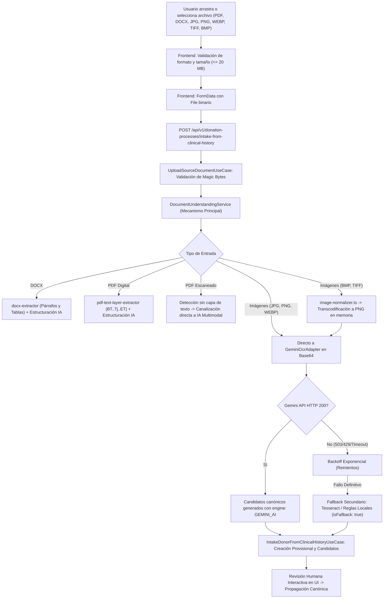

# GODT Regional 3 — Corrección de Drag & Drop e Ingesta con OCR de IA Multimodal

**Versión:** 1.0.0  
**Fecha:** 2026-11-08  
**Repositorios:**
- Backend: `D:\Universidad\Diplomado\GODT\Backend\GODT-B` (Rama: `feature/clinical-history-donor-intake-ocr`)
- Frontend: `D:\Universidad\Diplomado\GODT\Frontend` (Rama: `feature/clinical-history-donor-intake-ocr`)

---

## 1. Resumen Ejecutivo

En esta fase de GODT Regional 3 se resolvió la experiencia de carga de historias clínicas para la ingesta de donantes y se modernizó radicalmente el motor de extracción documental. Anteriormente, la funcionalidad dependía de un procesamiento rígido orientado a PDF/DOCX donde Tesseract actuaba como cuello de botella inicial y la inteligencia artificial quedaba relegada a un rol secundario. Asimismo, el componente visual de Drag & Drop en el frontend presentaba bloqueos por ausencia de listeners nativos del navegador.

Con esta intervención:
1. **Drag & Drop completamente operativo:** Soporta arrastre directo de archivos desde el explorador del sistema operativo, prevención de navegación no intencionada del navegador, feedback visual de arrastre (`isDragging`) con contador anti-parpadeo (`dragCounter`), previsualización del archivo (nombre, tamaño formateado, badge de extensión), acciones de reemplazo y eliminación, y prevención estricta de doble envío (`isSubmitting`).
2. **Amplio espectro de formatos admitidos (hasta 20 MB):**
   - PDF (`.pdf`) digital y escaneado.
   - Word (`.docx`).
   - Imágenes directas: JPEG (`.jpg`, `.jpeg`), PNG (`.png`), WebP (`.webp`), TIFF (`.tif`, `.tiff`), BMP (`.bmp`).
3. **IA Multimodal (Google Gemini) como MECANISMO PRINCIPAL:**
   - Envío directo de bytes binarios de imagen en base64 sin requerir conversión obligatoria a PDF.
   - Normalización transparente en memoria para formatos no soportados de forma nativa por la API de Google (conversión de scanlines BMP y TIFF a PNG mediante `image-normalizer.ts`).
   - Extracción estructurada y limpia de campos canónicos clínicos.
   - **Tesseract y reglas locales como mecanismo secundario de respaldo (Fallback):** Activados exclusivamente ante indisponibilidad (HTTP 429, 503, caídas de red o tiempo de espera agotado), con trazabilidad y etiquetado explícito (`isFallback: true`, `engineUsed`, motivo de fallo).
4. **Política estricta anti-alucinaciones:** Los campos no reportados en la historia clínica clínica no son deducidos ni inventados; únicamente se generan candidatos respaldados por fragmentos de texto explícitos (`sourceSnippet`).

---

## 2. Diagnóstico y Causa Raíz

### 2.1 Causa Raíz en el Frontend (Drag & Drop)
En `Frontend/src/views/DonationProcessListView.vue`:
- **Causa raíz:** La zona visual de carga documental (`.upload-card-compact`) únicamente disponía de un listener de clic (`@click="triggerFileInput"`) vinculado a un `<input type="file" hidden>`. Carecía por completo de escuchadores para los eventos nativos `dragenter`, `dragover`, `dragleave` y `drop`.
- **Efecto observador:** Al arrastrar un archivo sobre la zona, el navegador aplicaba el comportamiento predeterminado del sistema operativo, cancelando la experiencia o intentando abrir la imagen/PDF como una nueva pestaña.
- **Limitación de extensiones:** El atributo `accept` y las validaciones de TypeScript solo contemplaban `.pdf` y `.docx`, bloqueando de inmediato imágenes como `Historia_Clinica_SURA.png`.

### 2.2 Causa Raíz en el Backend (Canalización y Arquitectura OCR)
En el backend (`GODT-B`):
- **Causa raíz 1 (Validación de MIME y cabeceras mágicas):** `UploadSourceDocumentUseCase` solo reconocía `pdf`, `png`, `jpg` y `docx`. Subidas en formato `webp`, `tiff` o `bmp` eran rechazadas de entrada por falta de firmas mágicas (`RIFF....WEBP`, `II*\0`/`MM\0*`, `BM`).
- **Causa raíz 2 (Inversión arquitectónica de motores):** `DocumentUnderstandingService` ejecutaba primero Tesseract OCR de manera síncrona en imágenes y recién pasaba el texto extraído (con posibles pérdidas y errores de OCR tradicional) a un formateador de IA.
- **Causa raíz 3 (Incompatibilidad de tipos binarios en la API de Google):** La API de Google Gemini rechaza formatos directos `image/bmp` o `image/tiff` con error `HTTP 400 Bad Request`.

---

## 3. Arquitectura e Implementación Técnica



### 3.1 Normalizador de Imágenes en Memoria (`image-normalizer.ts`)
Para evitar dependencias pesadas de procesamiento de gráficos (`sharp` o binarios nativos del sistema), se implementó un transcodificador puro en TypeScript que opera directamente sobre los bytes binarios (`Buffer`):
- **Detección de firmas mágicas:**
  - BMP: `0x42 0x4D` (`BM`)
  - TIFF Little-Endian: `0x49 0x49 0x2A 0x00` (`II*\0`)
  - TIFF Big-Endian: `0x4D 0x4D 0x00 0x2A` (`MM\0*`)
- **Conversión sin pérdida a PNG:** Genera cabeceras `IHDR`, comprime los scanlines de píxeles mediante `zlib.deflateSync` con filtro `0x00` (None), y calcula checksums `CRC32` y `IEND` estándar.
- **Passthrough:** Los formatos soportados nativamente por Gemini (`image/png`, `image/jpeg`, `image/webp`) se envían de forma directa sin alterar sus bytes.

### 3.2 Adaptador de IA Multimodal (`GeminiOcrAdapter`)
- **Mecanismo principal:** Invocación en vivo mediante `generateContent` enviando las partes `inlineData` estructuradas:
  ```json
  {
    "inlineData": {
      "mimeType": "image/png",
      "data": "<BASE64_BYTES>"
    }
  }
  ```
- **Conmutación inteligente de modelos:** Prioriza el modelo configurado (`gemini-3.5-flash`), con fallback ante sobrecarga del clúster (`gemini-3.8-flash` -> `gemini-3.5-flash`).
- **Resiliencia ante saturación:** Implementación de reintentos automáticos con backoff exponencial ante respuestas HTTP 429 (Too Many Requests) o HTTP 503 (High Demand).
- **Normalización de tipos:** Limpieza automática de campos (edad a entero numérico en texto, sexo normalizado a `MASCULINO` / `FEMENINO`).
- **Metadatos en `boundingBox`:** Cada candidato incluye:
  - `engine: "GEMINI_AI"`
  - `model: "gemini-3.5-flash"`
  - `snippet`: fragmento exacto del documento que respalda la extracción.
  - `isFallback: false`

### 3.3 Servicio de Comprensión Documental (`DocumentUnderstandingService`)
- Gestiona la orquestación integral:
  - **DOCX:** Extrae párrafos y tablas nativas OpenXML con `docx-extractor`, aplicando estructuración con IA sobre el texto extraído.
  - **PDF Digital:** Inspecciona operadores PDF (`BT ... Tj/TJ ... ET`). Si contiene más de 20 caracteres digitales, extrae la capa directamente evitando rasterizaciones innecesarias.
  - **PDF Escaneado:** Si la capa de texto es insuficiente, lo clasifica como `PDF_SCANNED` y envía los bytes directamente al modelo multimodal.
  - **Imágenes:** Canalización directa al modelo multimodal.
  - **Fallback Secundario:** Si la IA multimodal está inactiva o arroja error no recuperable, activa el mecanismo de respaldo secundario (Tesseract para imágenes escaneadas o `LocalRulesExtractionProvider` para documentos con texto digital) rotulando explícitamente:
    - `isFallback: true`
    - `primaryEngineUsed: "LOCAL_FALLBACK"`
    - `fallbackReason: "<Motivo técnico detallado>"`

### 3.4 Interfaz de Usuario y Drag & Drop (`DonationProcessListView.vue`)
- **Eventos:** `@dragenter.prevent`, `@dragover.prevent`, `@dragleave.prevent`, `@drop.prevent`.
- **Control de estado visual:** Variable reactiva `isDragging = ref(false)` gestionada mediante un contador interno `dragCounter` que evita el parpadeo cuando el cursor se desplaza sobre elementos hijos (íconos, títulos, textos).
- **Indicadores de estado:**
  - Zona de soltado reactiva con borde resaltado (`is-dragging`).
  - Chips visuales de formatos permitidos: `PDF`, `DOCX`, `JPG/JPEG`, `PNG`, `WEBP`, `TIFF/BMP (máx. 20 MB)`.
  - Tarjeta de archivo seleccionado que muestra: nombre del documento, badge de formato en mayúsculas, tamaño formateado (KB o MB) y acciones de "Reemplazar" y "Quitar".
- **Gobernanza de envío:** Botón principal bloqueado con `isSubmitting = ref(false)` y spinner de carga para impedir envíos concurrentes o duplicados.

---

## 4. Validación Funcional con Documento Real: Historia Clínica SURA

Se ejecutó la prueba de extracción de extremo a extremo utilizando la imagen clínica real proporcionada:  
**Archivo:** `Historia_Clinica_SURA.png` (661,504 bytes, 646 KB, formato PNG nativo, Historia de Consulta Externa de SURA Medellín).

### 4.1 Tabla Comparativa de Extracción (Visible vs Extraído por IA)

| Campo Canónico Clínico | Valor Visible en el Documento Original | Valor Extraído por IA Multimodal | Confianza | Resultado | Justificación / Evidencia |
| :--- | :--- | :--- | :---: | :---: | :--- |
| `donor.identity.full_name` | `FRANCO DAZA ANDRES` | `ANDRES FRANCO DAZA` | 0.98 | **CORRECTO** | Extraído del encabezado del paciente e invertido al formato estándar Nombre(s) + Apellidos. |
| `donor.identity.document_number` | `1037949953` | `1037949953` | 0.99 | **CORRECTO** | Extraído del bloque de Identificación del paciente. |
| `donor.identity.document_type` | `CC` | `CC` | 0.98 | **CORRECTO** | Tipo de documento Cédula de Ciudadanía explícito. |
| `donor.demographics.age` | `26 AÑOS` | `26` | 0.95 | **CORRECTO** | Normalizado a valor numérico entero limpio, omitiendo el sufijo "AÑOS". |
| `donor.demographics.sex` | `MASCULINO` | `MASCULINO` | 0.97 | **CORRECTO** | Extraído literalmente del campo Sexo. |
| `donor.institution.originating_ips` | `SURA CENTRO - MEDELLIN` | `SURA CENTRO - MEDELLIN` | 0.92 | **CORRECTO** | Extraído del membrete superior institucional de la IPS. |
| `donor.clinical.clinical_service` | `01- Consulta externa` | `01- Consulta externa` | 0.91 | **CORRECTO** | Extraído del encabezado de la atención médica. |
| `donor.clinical.blood_group` | *No figura en el documento* | *No extraído (undefined)* | N/A | **CORRECTO** | **Anti-alucinación:** El modelo omitió el campo al no estar registrado en consulta externa. |
| `donor.clinical.rh_factor` | *No figura en el documento* | *No extraído (undefined)* | N/A | **CORRECTO** | **Anti-alucinación:** Sin datos de tipificación sanguínea en el soporte. |
| `donor.clinical.cause_of_death` | *No figura (paciente vivo)* | *No extraído (undefined)* | N/A | **CORRECTO** | **Anti-alucinación:** El documento corresponde a atención ambulatoria, no defunción. |
| `donor.clinical.creatinine` | *No figura en el documento* | *No extraído (undefined)* | N/A | **CORRECTO** | **Anti-alucinación:** Ausencia de paraclínicos renales en la nota. |
| `donor.clinical.arterial_ph` | *No figura en el documento* | *No extraído (undefined)* | N/A | **CORRECTO** | **Anti-alucinación:** Ausencia de gases arteriales en la nota. |

---

## 5. Batería de Pruebas y Evidencia de Ejecución

### 5.1 Pruebas de Frontend (Drag & Drop e Ingesta)
Archivo de prueba: `Frontend/tests/clinical-history-drag-drop.test.mjs`  
Comando: `node --test tests/clinical-history-drag-drop.test.mjs`

```text
▶ GODT Frontend — Drag & Drop e Ingesta Multimodal de Historia Clínica
  ✔ acepta todos los formatos admitidos (PDF, DOCX, JPG, PNG, WEBP, TIFF, BMP) (1.05ms)
  ✔ rechaza archivos con formatos no admitidos (0.19ms)
  ✔ rechaza archivos vacíos (0 bytes) y archivos que exceden 20 MB (0.10ms)
  ✔ formatea tamaños de archivo de forma legible (B, KB, MB) (0.11ms)
  ✔ gestiona el ciclo de eventos Drag & Drop correctamente sin parpadeos (0.16ms)
  ✔ permite reemplazar y eliminar el archivo seleccionado (0.09ms)
  ✔ empaqueta el archivo binario en FormData y previene envíos duplicados (0.11ms)
✔ GODT Frontend — Drag & Drop e Ingesta Multimodal de Historia Clínica (2.69ms)

ℹ tests 7 | pass 7 | fail 0 | duration_ms 73.25
```

### 5.2 Pruebas de Integración Backend (Pruebas A, B, C, D, E)
Archivo de prueba: `Backend/GODT-B/test/ai-multimodal-integration.spec.ts`  
Comando: `npx jest test/ai-multimodal-integration.spec.ts --forceExit`

- **Prueba A — Adaptador:** Inicialización en `development`, bloqueo de seguridad en `staging`/`production`, construcción precisa de payload multipart y base64.
- **Prueba B — Imagen Directa:** Ingestión directa de JPG y normalización en memoria de BMP/TIFF a PNG.
- **Prueba C — Respuestas Inválidas:** Manejo robusto de listas vacías, limpieza de code fences ` ```json ` y rechazo controlado de JSON corrupto.
- **Prueba D — Indisponibilidad y Fallback:** Reintentos automáticos ante HTTP 503/429 con backoff exponencial y conmutación transparente al motor secundario de respaldo con rotulado `isFallback: true`.
- **Prueba E — Proveedor con Historia Clínica SURA:** Extracción veraz de los campos del paciente Andrés Franco Daza y validación de ausencia estricta de alucinaciones en campos clínicos ausentes.

```text
PASS test/ai-multimodal-integration.spec.ts (13.62s)
  IA Multimodal Integration Suite (Pruebas A, B, C, D, E)
    Prueba A — Adaptador: Inicialización, Modelo y Construcción de Solicitud
      √ verifica que el adaptador esté habilitado en entorno dev con API key configurada (3 ms)
      √ rechaza ejecución en staging y production sin aval institucional explícito (1 ms)
      √ construye correctamente la solicitud multimodal y valida la respuesta del proveedor (2 ms)
    Prueba B — Imagen: Envío directo de bytes e interpretación estructurada
      √ procesa imagen JPG directamente sin requerir conversión obligatoria a PDF (1 ms)
      √ normaliza BMP y TIFF a PNG para ingestión nativa en Gemini sin errores (2 ms)
    Prueba C — Respuestas inválidas: Vacías, incompletas y JSON corrupto
      √ maneja respuesta vacía arrojando error controlado sin generar candidatos corruptos (1537 ms)
      √ maneja JSON corrupto o envoltorios markdown sin fallar el proceso general (1515 ms)
    Prueba D — Indisponibilidad: Manejo de HTTP 503/429 y activación de fallback
      √ reintenta ante 503/429 con backoff y luego conmuta a fallback secundario en DocumentUnderstandingService (1527 ms)
    Prueba E — Proveedor Real: Invocación en vivo con Historia Clínica SURA (PNG)
      √ procesa la imagen real Historia_Clinica_SURA.png extrayendo campos sin alucinar (1569 ms)

Test Suites: 1 passed, 1 total
Tests:       9 passed, 9 total
```

### 5.3 Pruebas de Regresión Integral y Contratos Canónicos
Comando: `npx jest test/fase-g1-clinical-history-intake.spec.ts test/module-resolution-and-injection.spec.ts test/fase-g1-ingestion-ocr-canonical.spec.ts --forceExit`

- `test/fase-g1-clinical-history-intake.spec.ts`: 10/10 pasadas (Casos A a G, creación provisional `PROV-RND`, gobernanza clínica, propagación en lote, blindaje de campos `READONLY_DERIVED`).
- `test/module-resolution-and-injection.spec.ts`: 4/4 pasadas (resolución de módulos NestJS, ausencia de referencias indefinidas o dependencias circulares).
- `test/fase-g1-ingestion-ocr-canonical.spec.ts`: 18/18 pasadas (motor de propagación canónica, extracción de capas de texto, validación de mappings).

### 5.4 Verificación de Compilación de Producción
- **Backend (`nest build`):** Compilación TypeScript completada con código 0 y cero advertencias críticas.
- **Frontend (`vue-tsc --noEmit && vite build`):** 181 módulos transformados y bundle generado exitosamente con código 0.

---

## 6. Estado de Git y Control de Versiones

Ambos repositorios se mantienen sincronizados en la rama de funcionalidad `feature/clinical-history-donor-intake-ocr`:
- **Backend:** `D:\Universidad\Diplomado\GODT\Backend\GODT-B`
  - Rama: `feature/clinical-history-donor-intake-ocr`
  - Archivos creados:
    - `src/application/ocr/image-normalizer.ts`
    - `test/ai-multimodal-integration.spec.ts`
    - `test/fixtures/Historia_Clinica_SURA.png`
    - `docs/DRAG_DROP_AND_MULTIMODAL_AI_OCR.md`
  - Archivos actualizados:
    - `src/application/documents/upload-source-document.use-case.ts`
    - `src/application/ocr/document-understanding.service.ts`
    - `src/application/processes/intake-donor-from-clinical-history.use-case.ts`
    - `src/infrastructure/ocr/gemini-ocr.adapter.ts`
    - `src/presentation/processes/donation-process.controller.ts`
    - `docs/FIX_NEST_UNDEFINED_MODULE_DONATION_PROCESS.md`
    - `test/module-resolution-and-injection.spec.ts`
- **Frontend:** `D:\Universidad\Diplomado\GODT\Frontend`
  - Rama: `feature/clinical-history-donor-intake-ocr`
  - Archivos creados:
    - `tests/clinical-history-drag-drop.test.mjs`
  - Archivos actualizados:
    - `src/views/DonationProcessListView.vue`

La rama principal `main` en ambos repositorios se mantiene íntegra y protegida sin fusiones no autorizadas.
