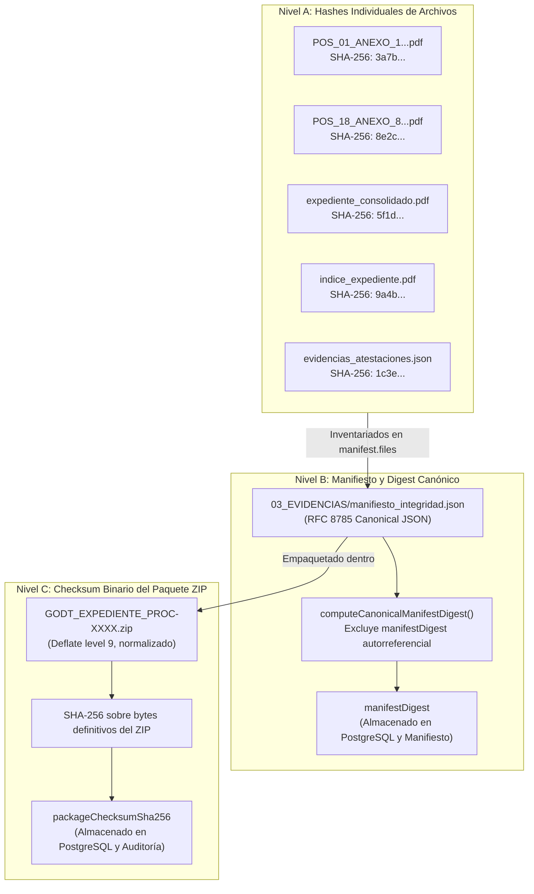

# GODT REGIONAL 3 — REPORTE DE AUDITORÍA Y ENDURECIMIENTO FASE E.1
## ENDURECIMIENTO CRIPTOGRÁFICO, DETERMINISMO, DURABILIDAD Y VALIDACIÓN DEL EXPEDIENTE EXPORTADO

**Fecha:** 2026-11-07  
**Sistema:** GODT Regional 3 — Gestión Operativa de la Donación y Trasplantes  
**Módulos:** Backend (`GODT-B`) y Frontend (`GODT-Frontend`)  
**Estado:** `INTEGRIDAD Y EXPORTACIÓN VALIDADAS`  

---

### 1. RESOLUCIÓN DE LOS 5 HALLAZGOS PRINCIPALES

| # | Hallazgo Inicial | Causa Raíz Identificada | Solución Implementada y Verificada |
|---|---|---|---|
| **1** | **Autorreferencia circular del Checksum del ZIP** | El hash del ZIP final se intentaba incluir en el `manifiesto_integridad.json` que está empaquetado dentro de ese mismo ZIP. | **Tres niveles criptográficos estrictamente desacoplados:** • **Nivel A:** Hashes SHA-256 binarios individuales en `manifest.files` para cada archivo del ZIP. • **Nivel B:** Digest canónico determinista (`manifestDigest`) calculado con serialización recursiva ordenada (RFC 8785) sobre el contenido del manifiesto. • **Nivel C:** Checksum binario del ZIP (`packageChecksumSha256`), computado tras el cierre del archivo y almacenado únicamente en PostgreSQL y eventos de auditoría. |
| **2** | **Determinismo vs. Reproducibilidad Lógica** | Ambigüedad entre determinismo binario absoluto y reproducibilidad lógica ante la presencia de metadatos de sesión (timestamps, exportId, firmante). | **Definición formal:** • *Documentos Originales:* **Determinismo Criptográfico Absoluto** (100% inmutables byte a byte con SHA-256 idéntico). • *Manifiesto:* **Reproducibilidad Semántica y Digest Canónico** (mismo hash canónico al evaluar el mismo estado congelado del proceso). • *PDF Consolidado:* **Reproducibilidad Estructural** (orden de folios, carátula e índice idénticos). • *Paquete ZIP:* **Reproducibilidad Lógica con Sesión Única** (cada exportación genera un ZIP independiente con su propio `exportId` y `generatedAt` para trazabilidad y no-repudio). |
| **3** | **Falta de durabilidad en fallback `setImmediate`** | Si Redis no estaba disponible, la cola realizaba un fallback volátil en memoria sin persistencia ni reintentos. | **Política de entornos estricta:** • *Producción (`NODE_ENV === 'production'`):* Redis/BullMQ es obligatorio. Si falla, se rechaza la solicitud con `DossierQueueUnavailableError` y código HTTP 503 Service Unavailable, evitando pérdida silenciosa de trabajos. • *Desarrollo/Testing:* Fallback controlado en memoria explícitamente advertido en logs. • *Recuperación de huérfanos (`recoverOrphanExports`):* Trabajos `PROCESSING` interrumpidos por reinicio del servicio se marcan de forma segura como `FAILED` para permitir reintento idempotente. |
| **4** | **Duplicación del Anexo 8 y nomenclatura inconsistente** | El PDF del Anexo 8 se duplicaba en `01_DOCUMENTOS_LIBERADOS` y `04_CADENA_CUSTODIA`. El Anexo 2 se denominaba incorrectamente "CONSENTIMIENTO". | **Alineación con `document-inventory.md`:** • El PDF oficial firmado de custodia reside una sola vez en `01_DOCUMENTOS_LIBERADOS/POS_18_ANEXO_8_ACTA_CADENA_CUSTODIA.pdf`. • En `04_CADENA_CUSTODIA/` se ubica `eventos_custodia_inmutables.json` y `referencia_anexo_8.json` (puntero formal sin duplicación binaria). • Nomenclatura oficial: `POS_02_ANEXO_2_NOTIFICACION_DEUDOS.pdf` (Ley 1805/2016 de presunción legal) y `POS_03_ANEXO_3_CONSENTIMIENTO_FAMILIAR.pdf`. |
| **5** | **Hashes ficticios de buffer vacío en atestaciones** | Aparecía el hash `e3b0c442...` (SHA-256 de string vacío) en participantes sin firma binaria. | **Validación estricta de evidencias:** • Descarte explícito de strings vacíos o hashes residuales (`snapshotSha256 = null`). • Clasificación formal: `attestationLevel = ATESTA_MANUAL_INTERNA` o `FIRMA_ELECTRONICA_SIMPLE`. • Opción `DIGITAL_CERTIFICADA` bloqueada con aviso técnico-legal en `evidencias_atestaciones.json` hasta integración formal con prestador PKI acreditado por ONAC. |

---

### 2. ARQUITECTURA DE TRES NIVELES CRIPTOGRÁFICOS

---

### 3. MATRIZ DE PRUEBAS DE INTEGRACIÓN (22 ESCENARIOS APROBADOS AL 100%)

La suite [`dossier-export-integration.spec.ts`](file:///d:/Universidad/Diplomado/GODT/Backend/GODT-B/test/dossier-export-integration.spec.ts) ejecuta 22 escenarios contra PostgreSQL real:

1. **Escenario 20:** Rechazo de acceso a proceso de donación para usuario de otra IPS.
2. **Escenario 4:** Rechazo de inclusión de documentos fuente sin rol de Coordinador/Admin.
3. **Escenarios 1 & 2:** Exportación exitosa con dos documentos liberados sin fuentes complementarias por defecto.
4. **Escenario 6:** Generación de paquete ZIP con taxonomía de 6 carpetas y magic bytes `0x504b0304`.
5. **Escenario 7:** Verificación de inmutabilidad de binarios y hashes en `01_DOCUMENTOS_LIBERADOS`.
6. **Escenario 5:** Compilación secuencial de folios, carátula e índice en `02_DOCUMENTO_CONSOLIDADO/expediente_consolidado.pdf`.
7. **Escenario 8:** Verificación de serialización canónica recursiva (RFC 8785) y ausencia de autorreferencia en `manifiesto_integridad.json`.
8. **Escenario 9:** Comprobación de `packageChecksumSha256` en PostgreSQL coincidente con el hash real del ZIP en almacenamiento.
9. **Escenario 3:** Inclusión de `05_FUENTES_COMPLEMENTARIAS/` únicamente bajo solicitud y juramento institucional.
10. **Caso Base:** Validación completa de integridad (`INTEGRITY_VERIFIED`) cuando todos los elementos coinciden.
11. **Escenario 10:** Detección de archivo alterado (`INTEGRITY_COMPROMISED`) y reporte de archivo con hash no coincidente.
12. **Escenario 11:** Detección de archivo faltante (`INTEGRITY_COMPROMISED`) si un documento inventariado fue removido del ZIP.
13. **Escenario 12:** Detección de archivo inyectado no inventariado (`INTEGRITY_COMPROMISED`).
14. **Escenario 13:** Detección de manipulación interna del JSON del manifiesto mediante discrepancia de `manifestDigest`.
15. **Escenario 14:** Detección de reemplazo integral del ZIP por binario ajeno.
16. **Escenario 15:** Idempotencia: solicitudes recurrentes retornan la exportación en curso sin duplicar registros.
17. **Escenario 19:** Concurrencia atómica entre múltiples transacciones.
18. **Escenario 16:** Fallback seguro en segundo plano permitido en entorno de desarrollo.
19. **Escenario 17:** Rechazo estricto con `DossierQueueUnavailableError` en producción si Redis se encuentra inactivo.
20. **Escenario 18:** Recuperación de trabajos `PROCESSING` abandonados por reinicio del servicio (transición a `FAILED`).
21. **Prueba de Repetición:** Dos exportaciones sobre el mismo proceso congelado producen hashes idénticos en documentos originales y mismo digest canónico.
22. **Prueba de Atestaciones:** `evidencias_atestaciones.json` refleja firmas reales y descarta hashes vacíos.

---

### 4. BASE DE DATOS Y MIGRACIÓN 14

- **Migración 14:** `20261107140000_dossier_hardening_phase_e1` aplicada exitosamente.
- **Columnas añadidas a `PROCESS_DOSSIER_EXPORT`:**
  - `package_checksum_sha256` (`CHAR(64)`): Hash binario del ZIP final.
  - `manifest_digest` (`CHAR(64)`): Digest canónico determinista del manifiesto de integridad.
- **Retrocompatibilidad:** Datos históricos de `zip_sha256` sincronizados en `package_checksum_sha256`.
