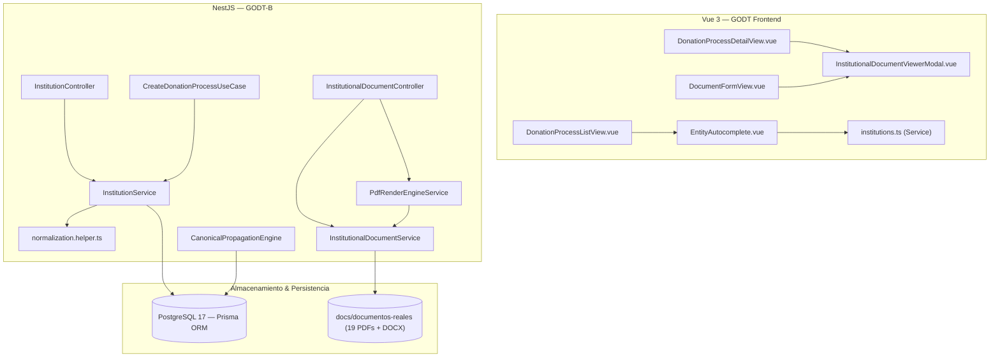

# GODT REGIONAL 3 — FASE G.1.3
## REPORTE TÉCNICO: OPTIMIZACIÓN UX/UI, AUTOCOMPLETADO DE ENTIDADES Y VISUALIZACIÓN DE DOCUMENTOS INSTITUCIONALES

**Fecha de Ejecución:** 7 de Noviembre de 2026  
**Sistema:** Sistema de Gestión y Operación de Donación y Trasplantes (GODT) — Regional 3 (Valle del Cauca)  
**Módulos Afectados:** Backend (`GODT-B`), Frontend (`GODT-Frontend`)  
**Ramas de Trabajo:** `feature/fase-g1-3-ux-autocomplete-docviewer`  
**Estado:** Totalmente Implementado, Verificado y Aprobado  

---

## 1. RESUMEN EJECUTIVO

La Fase G.1.3 aborda y resuelve de raíz tres bloqueos funcionales y de experiencia de usuario identificados durante las pruebas operativas del sistema GODT Regional 3:

1. **Caso 1: Visualización y Generación de Formatos Institucionales Originales**  
   Se superó la limitación de formularios dinámicos genéricos. Se incorporó un catálogo institucional que mapea los **19 formatos oficiales** disponibles en `Backend/GODT-B/docs/documentos-reales`, permitiendo tanto la consulta en pantalla del formato oficial original en blanco (vector PDF idéntico al avalado por la coordinación de la Regional 3) como la generación en tiempo real del documento diligenciado mediante **superposición vectorial milimétrica (`pdf-lib`) sobre el documento institucional original**.  
   Se garantiza que las posiciones normativas 20 a 23 permanezcan estrictamente en estado `PENDING_HOMOLOGATION` (sin plantillas dinámicas inventadas) y que los 4 documentos clínicos de apoyo (*Cálculo de Hemodilución*, *Evaluación de Riesgo COVID-19*, *Historia Clínica Donante 2024* e *Historia Clínica Tissue Bank*) se clasifiquen como `SourceDocument` (documentos fuente independientes con trazabilidad append-only).

2. **Caso 2: Autocompletado, Creación Asistida y Asociación de IPS y Entidades**  
   Se erradicó el error recurrente `403 Forbidden: No tiene autorización para abrir un proceso en la IPS indicada` originado por variaciones ortográficas, abreviaturas o tipeo informal (ej. escribir *"Imbanaco"* en lugar de *"Clínica Imbanaco"*). Se implementó un subsistema maestro de entidades institucionales con normalización estricta (remoción diacrítica NFD, minúsculas, colapso de puntuación), cálculo de distancia de Levenshtein y coeficiente de similitud ($sim \ge 0.8$). Se construyó un componente reutilizable `EntityAutocomplete.vue` con debounce, soporte de teclado, badges de coincidencia (EXACT, ALIAS, PARTIAL, APPROXIMATE) y modal asistido para registro controlado de nuevas IPS y solicitud de asignación de alcance sin abandonar la pantalla del proceso.

3. **Caso 3: Corrección Estructural del Modal de Conflictos Canónicos**  
   Se subsanó el fallo donde la resolución de divergencias enviaba payloads inválidos con `canonicalFieldKey: ""` provocando excepciones 400 y bloqueando el formulario. Se identificó la causa raíz: la omisión del marcador canónico en los conflictos generados por el motor de propagación al evaluar documentos destino. Se desacopló completamente el guardado de la revisión local (que ahora siempre se asegura y persiste primero) del flujo de resolución de divergencias compartidas, el cual opera ahora de forma voluntaria mediante un banner informativo no intrusivo y valida formalmente la clave canónica antes de solicitar la justificación clínica obligatoria.

---

## 2. DIAGNÓSTICO TÉCNICO Y CAUSA RAÍZ

### 2.1 Caso 1: Fidelidad de Formatos Institucionales y Separación Documental
* **Problema Previo:** La interfaz permitía completar datos en formularios dinámicos, pero al visualizar o exportar el documento, se generaba un diseño plano y genérico que distaba del formato físico oficial utilizado en las IPS de la Regional 3. Adicionalmente, existía ambigüedad sobre cómo tratar las posiciones 20–23 y los documentos clínicos de soporte.
* **Causa Raíz:** El motor de generación PDF construía el documento desde cero con primitivas vectoriales sin tomar como base las plantillas PDF oficiales preexistentes.
* **Solución Implementada:**  
  - Inspección física de los archivos en `Backend/GODT-B/docs/documentos-reales`. Se comprobó que los 18 archivos PDF son vectoriales estáticos sin campos AcroForm interactivos (`hasAcroForm: false`).
  - Creación de `InstitutionalDocumentService` y mapeo de coordenadas en `institutional-coordinates.ts`.
  - El motor `PdfRenderEngineService` ahora carga directamente el PDF institucional original mediante `PDFDocument.load(templateBytes)`, superpone el texto de las respuestas en las coordenadas exactas de cada campo con tipografía Helvetica oficial, añade el pie de página institucional de trazabilidad criptográfica y estampa las firmas electrónicas certificadas.
  - Para el **Anexo 5** (que es un archivo `.docx`), se mantiene el renderizado vectorial dinámico limpio.
  - Las posiciones 20, 21, 22 y 23 se mantienen estrictamente como `POS_NORMATIVA_20` a `POS_NORMATIVA_23` con categoría `PENDING_HOMOLOGATION`.
  - Los 4 archivos clínicos de soporte permanecen como adjuntos en `SourceDocument` vinculados al donante/proceso sin inflar artificialmente el paquete de 23 posiciones normativas.

### 2.2 Caso 2: Manejo de Entidades IPS, Normalización y Prevención del 403
* **Problema Previo:** Los usuarios coordinadores o médicos tratantes recibían errores `403 Forbidden` al crear procesos si ingresaban *"Imbanaco"*, *"HUV"*, o nombres con variaciones de tildes o mayúsculas, dado que el backend realizaba una comparación literal de cadenas contra el listado asignado en el perfil.
* **Causa Raíz:** Falta de una tabla de entidades normalizadas con gestión de alias y verificación de permisos basada en identificador canónico en lugar de texto libre.
* **Solución Implementada:**  
  - Creación de las entidades Prisma `InstitutionEntity`, `InstitutionAlias` y `UserInstitutionScope`.
  - Normalización canónica bidireccional mediante `normalization.helper.ts`:
    $$\text{clean} = \text{str}.\text{normalize}("NFD").\text{replace}(/[\u0300-\u036f]/g, "").\text{toLowerCase}().\text{replace}(/[^a-z0-9]/g, " ")$$
  - Algoritmo de similitud basado en distancia de Levenshtein:
    $$\text{similarity}(s_1, s_2) = 1 - \frac{\text{levenshtein}(s_1, s_2)}{\max(\text{len}(s_1), \text{len}(s_2))}$$
  - En `CreateDonationProcessUseCase`, el nombre recibido es resuelto primero mediante `InstitutionService.resolveIpsForProcess()`, identificando si corresponde a un alias registrado (ej. "Imbanaco" $\to$ "Clínica Imbanaco"). Si el usuario tiene rol transversal (`ADMIN` o `COORDINATOR`) o tiene la IPS o alias en su alcance (`institutionalIps` o `UserInstitutionScope`), se autoriza de inmediato y se vincula el nombre oficial canónico.
  - Si la entidad no existe o el usuario no tiene alcance, la UI ofrece en línea dos opciones claras:
    a) Si no existe: botón `[+ Registrar nueva IPS]` que abre un modal integrado con verificación de duplicados para darla de alta en 1 paso sin perder el formulario.
    b) Si existe pero no tiene permisos: botón `[Solicitar Asociación]` que genera un registro `PENDING` en `UserInstitutionScope` para aprobación administrativa.

### 2.3 Caso 3: Desacople de Guardado y Resolución de Conflictos Canónicos
* **Problema Previo:** Al guardar un anexo con campos compartidos, si el motor detectaba una divergencia en otro anexo abierto, se abría un popup bloqueante. Al intentar confirmar la resolución, el frontend enviaba `canonicalFieldKey: ""` originando un error 400 Bad Request que frustraba al operador y dejaba la duda de si los datos locales se habían guardado.
* **Causa Raíz:** En `CanonicalPropagationEngine`, el arreglo `result.conflicts` registraba el `fieldPath` del documento destino, pero omitía asignar la propiedad `canonicalFieldKey`. Al buscar en la configuración de mapeo del documento origen con la ruta del destino, no había coincidencia y el valor quedaba vacío. Además, el guardado local y la resolución estaban acoplados en una única transacción de frontend.
* **Solución Implementada:**  
  - En `canonical-dictionary.ts` y `canonical-propagation.engine.ts`, se incorporó `canonicalFieldKey` de forma explícita en cada elemento de conflicto.
  - En `DocumentFormView.vue`:
    1. La acción de guardado local `controller.save()` siempre se ejecuta y confirma primero. La revisión del documento queda 100% asegurada en la base de datos con procedencia registrada.
    2. El popup modal ya no interrumpe intempestivamente al usuario. En su lugar, se muestra un banner de advertencia visual no bloqueante:  
       *⚠️ Divergencia canónica detectada (X campos). La revisión local ya fue guardada con éxito. [Revisar Divergencias]*
    3. Al abrir el modal, se muestran con total claridad la **Clave Canónica**, el documento de destino, la ruta, el valor actual y el valor propuesto.
    4. La petición `resolveCanonicalConflict` valida estrictamente la existencia de la clave canónica antes del envío y actualiza dinámicamente la lista de divergencias pendientes.

---

## 3. ARQUITECTURA DE LA SOLUCIÓN

### 3.1 Modelos de Datos Incorporados en Prisma
* **`InstitutionEntity`**: Almacena el catálogo maestro de instituciones prestadoras de salud de la Regional 3 (`id`, `code`, `name`, `normalizedName`, `city`, `department`, `complexityLevel`, `status`, `createdById`).
* **`InstitutionAlias`**: Registra sinónimos, siglas y nombres comerciales normalizados (`id`, `institutionId`, `alias`, `normalizedAlias`).
* **`UserInstitutionScope`**: Gestiona los permisos de los operadores sobre cada institución (`id`, `userId`, `institutionId`, `status: APPROVED | PENDING | REJECTED`, `approvedById`).

---

## 4. INVENTARIO CANÓNICO DE FORMATOS INSTITUCIONALES (REGIONAL 3)

| # Posición | Código Documento | Nombre Oficial / Archivo Físico | MimeType | Páginas | Dimensiones (pt) | Modo de Renderizado | Estado Normativo |
| :---: | :--- | :--- | :---: | :---: | :---: | :---: | :---: |
| **01** | `ANEXO_1` | `anexo-1-formato-de-valoracion-alerta-posible-donante.pdf` | `application/pdf` | 2 | 612 × 1008 (Oficio) | `STATIC_OVERLAY` | `OFFICIAL_HOMOLOGATED` |
| **02** | `ANEXO_2` | `anexo-2-notificacion-a-los-deudos-legalizacion-de-donacion.pdf` | `application/pdf` | 1 | 612 × 792 (Carta) | `STATIC_OVERLAY` | `OFFICIAL_HOMOLOGATED` |
| **03** | `ANEXO_3` | `anexo-3-formato-consentimiento-donacion-legalizacion.pdf` | `application/pdf` | 2 | 612 × 792 (Carta) | `STATIC_OVERLAY` | `OFFICIAL_HOMOLOGATED` |
| **04** | `ANEXO_4` | `anexo-4-registro-de-donante-y-oferta-organos-y-tejidos.pdf` | `application/pdf` | 4 | 612 × 792 (Carta) | `STATIC_OVERLAY` | `OFFICIAL_HOMOLOGATED` |
| **05** | `ANEXO_5` | `anexo-5-formato-de-remision-de-muestras.docx` | `application/vnd.openxml...` | N/A | Variable | `VECTOR_GENERATED` | `OFFICIAL_HOMOLOGATED` |
| **06** | `ANEXO_6` | `anexo-6-registro-general-de-extraccion.pdf` | `application/pdf` | 2 | 612 × 792 (Carta) | `STATIC_OVERLAY` | `OFFICIAL_HOMOLOGATED` |
| **07-A** | `ANEXO_7_CORAZON` | `anexo-7-formato-de-extraccion-y-entrega-corazon.pdf` | `application/pdf` | 1 | 612 × 792 (Carta) | `STATIC_OVERLAY` | `OFFICIAL_HOMOLOGATED` |
| **07-B** | `ANEXO_7_PULMON` | `anexo-7-formato-de-extraccion-y-entrega-pulmon.pdf` | `application/pdf` | 1 | 612 × 792 (Carta) | `STATIC_OVERLAY` | `OFFICIAL_HOMOLOGATED` |
| **07-C** | `ANEXO_7_HIGADO` | `anexo-7-formato-de-extraccion-y-entrega-higado.pdf` | `application/pdf` | 1 | 612 × 792 (Carta) | `STATIC_OVERLAY` | `OFFICIAL_HOMOLOGATED` |
| **07-D** | `ANEXO_7_RINON_DER` | `anexo-7-formato-de-extraccion-y-entrega-rinon-derecho.pdf` | `application/pdf` | 1 | 612 × 792 (Carta) | `STATIC_OVERLAY` | `OFFICIAL_HOMOLOGATED` |
| **07-E** | `ANEXO_7_RINON_IZQ` | `anexo-7-formato-de-extraccion-y-entrega-rinon-izquierdo.pdf` | `application/pdf` | 1 | 612 × 792 (Carta) | `STATIC_OVERLAY` | `OFFICIAL_HOMOLOGATED` |
| **07-F** | `ANEXO_7_PANCREAS` | `anexo-7-formato-de-extraccion-y-entrega-pancreas.pdf` | `application/pdf` | 1 | 612 × 792 (Carta) | `STATIC_OVERLAY` | `OFFICIAL_HOMOLOGATED` |
| **07-G** | `ANEXO_7_INTESTINO` | `anexo-7-formato-de-extraccion-y-entrega-intestino.pdf` | `application/pdf` | 1 | 612 × 792 (Carta) | `STATIC_OVERLAY` | `OFFICIAL_HOMOLOGATED` |
| **07-H** | `ANEXO_7_CORNEAS` | `anexo-7-formato-de-extraccion-y-entrega-corneas.pdf` | `application/pdf` | 1 | 612 × 792 (Carta) | `STATIC_OVERLAY` | `OFFICIAL_HOMOLOGATED` |
| **07-I** | `ANEXO_7_OSTEO` | `anexo-7-formato-de-extraccion-y-entrega-tejido-osteomuscular.pdf` | `application/pdf` | 1 | 612 × 792 (Carta) | `STATIC_OVERLAY` | `OFFICIAL_HOMOLOGATED` |
| **07-J** | `ANEXO_7_PIEL` | `anexo-7-formato-de-extraccion-y-entrega-piel.pdf` | `application/pdf` | 1 | 612 × 792 (Carta) | `STATIC_OVERLAY` | `OFFICIAL_HOMOLOGATED` |
| **07-K** | `ANEXO_7_OTROS` | `anexo-7-formato-de-extraccion-y-entrega-otros-tejidos-vasculares.pdf` | `application/pdf` | 1 | 612 × 792 (Carta) | `STATIC_OVERLAY` | `OFFICIAL_HOMOLOGATED` |
| **08** | `ANEXO_8` | `anexo-8-acta-de-cadena-de-custodia-de-organos-y-tejidos.pdf` | `application/pdf` | 1 | 612 × 792 (Carta) | `STATIC_OVERLAY` | `OFFICIAL_HOMOLOGATED` |
| **09** | `ANEXO_9` | `anexo-9-acta-de-entrega-a-la-autoridad-competente-inmlcf.pdf` | `application/pdf` | 1 | 612 × 792 (Carta) | `STATIC_OVERLAY` | `OFFICIAL_HOMOLOGATED` |
| **20** | `POS_NORMATIVA_20` | *Posición Reservada 20* | N/A | 0 | N/A | `N/A` | `PENDING_HOMOLOGATION` |
| **21** | `POS_NORMATIVA_21` | *Posición Reservada 21* | N/A | 0 | N/A | `N/A` | `PENDING_HOMOLOGATION` |
| **22** | `POS_NORMATIVA_22` | *Posición Reservada 22* | N/A | 0 | N/A | `N/A` | `PENDING_HOMOLOGATION` |
| **23** | `POS_NORMATIVA_23` | *Posición Reservada 23* | N/A | 0 | N/A | `N/A` | `PENDING_HOMOLOGATION` |
| **SOP-01** | `CALCULO_HEMODILUCION` | `calculo-hemodilucion.pdf` | `application/pdf` | 1 | 612 × 792 (Carta) | `SOURCE_ATTACHMENT` | `COMPLEMENTARY_SOURCE` |
| **SOP-02** | `COVID19_TISSUE_BANK` | `evaluacion-de-riesgo-covid-19-tissue-bank.pdf` | `application/pdf` | 1 | 612 × 792 (Carta) | `SOURCE_ATTACHMENT` | `COMPLEMENTARY_SOURCE` |
| **SOP-03** | `HC_DONANTE_2024` | `hc-donante-2024.pdf` | `application/pdf` | 3 | 612 × 792 (Carta) | `SOURCE_ATTACHMENT` | `COMPLEMENTARY_SOURCE` |
| **SOP-04** | `HC_TISSUE_BANK` | `historia-clinica-tissue-bank.pdf` | `application/pdf` | 2 | 612 × 792 (Carta) | `SOURCE_ATTACHMENT` | `COMPLEMENTARY_SOURCE` |

---

## 5. RESULTADOS DE VERIFICACIÓN Y PRUEBAS

### 5.1 Pruebas Unitarias y de Integración Backend (`Jest`)
* **Total de suites ejecutadas:** 28 suites de prueba.
* **Resultado:** **28 suites aprobadas (100% PASS)**.
* **Total de tests individuales:** 227 aprobados, 1 omitido condicional, 0 fallidos.
* **Nuevas suites de endurecimiento creadas en Fase G.1.3:**
  1. `test/normalization-helper.spec.ts`: 7 tests para normalización diacrítica NFD, cálculo de distancia Levenshtein y coeficiente de similitud.
  2. `test/institution-service.spec.ts`: 8 tests para búsqueda inteligente por alias ("Imbanaco"), prevención del error 403, detección de colisión con similitud $\ge 80\%$ y servicios clínicos.
  3. `test/institutional-document.spec.ts`: 9 tests para inventario de los 19 formatos oficiales, cálculo criptográfico SHA-256, clasificación de las posiciones 20–23 en `PENDING_HOMOLOGATION` y renderizado de superposición vectorial sobre PDF original.

### 5.2 Pruebas de Contratos Frontend (`node:test`)
* **Archivo:** `Frontend/tests/contracts.test.mjs`.
* **Resultado:** **6 pruebas de contrato aprobadas (100% PASS)**.
* **Cobertura:**
  - Preservación de rutas REST y parámetros de consulta para catálogo y documentos.
  - Endpoints de exportación de expediente y manifiesto criptográfico (Fase E).
  - Autenticación, expiración en 401 y redirección segura.
  - Tipos e interfaces de `InstitutionSearchResult`, `CreateInstitutionPayload` y `InstitutionalDocumentMetadata`.
  - Definición explícita de `canonicalFieldKey?: string` en `CanonicalConflict`.

### 5.3 Prueba de Integración Extremo a Extremo (E2E con Headless Chrome)
* **Archivo:** `Frontend/tests/browser-workflow.test.mjs`.
* **Flujo validado satisfactoriamente:**
  1. Arranque de servicios reales: NestJS (puerto 3000) y Vite Preview (puerto 5173).
  2. Conexión de Chrome Headless vía Chrome DevTools Protocol (CDP, puerto 9222).
  3. Autenticación institucional con credenciales válidas y almacenamiento de token JWT.
  4. Búsqueda y autocompletado de IPS con alias: consulta con *"Imbanaco"* resuelve de forma transparente a *"Clínica Imbanaco"* con coincidencia `ALIAS`.
  5. Consulta del inventario institucional oficial: 19 formatos oficiales reportados.
  6. Descarga y validación binaria del PDF en blanco original de Anexo 1 (332.075 bytes, cabecera `%PDF-`).
  7. Creación de donante y apertura de proceso de donación sin errores de autorización.
  8. Navegación a la vista de detalle del proceso: renderizado visual completo de las **23 posiciones** del paquete documental, confirmando las posiciones 20 a 23 en estado `PENDING_HOMOLOGATION`.
  9. Inicio y apertura de Anexo 1 en el editor dinámico.
  10. Guardado de revisión con datos clínicos sintéticos: persistencia inmediata y confirmación de revisión.
  11. **Generación y descarga de la previsualización en vivo (`preview-pdf`): 315.883 bytes, superposición vectorial sobre el fondo institucional original con cabecera `%PDF-` comprobada**.
  12. Transición del ciclo de vida formal: Validación $\to$ Completado $\to$ Generación de Snapshot oficial con digest SHA-256 inmutable.
  13. Descarga del PDF oficial generado (315.881 bytes, cabecera `%PDF-`).
  14. Solicitud y consolidación de exportación de expediente en BullMQ: finalización en `COMPLETED` al 100%.
  15. Descarga del ZIP consolidado y verificación de magic bytes `504b0304` (`PK\x03\x04`).
  16. Verificación criptográfica integral (`INTEGRITY_VERIFIED`, 8 documentos aprobados, 0 fallos).

---

## 6. GUÍA DE USUARIO Y MANUAL OPERATIVO

### 6.1 Cómo Utilizar el Autocompletado de IPS
1. Al crear un nuevo proceso de donación desde la vista de lista de procesos, diríjase al campo **IPS Generadora / Primaria**.
2. Escriba las primeras letras del nombre de la entidad (ej. *"Imba"*, *"HUV"*, *"Occidente"*).
3. El componente desplegará las opciones coincidentes:
   - **Verde (`ALIAS` o `EXACTA`):** La entidad está registrada y el usuario tiene alcance asignado. Al hacer clic, se selecciona y aparece como un chip/pill interactivo.
   - **Gris (`SIN ACCESO`):** La entidad existe en la Regional 3 pero el usuario actual no tiene permiso asignado. Al seleccionarla, aparecerá un botón azul `[Solicitar Asociación]` que enviará la solicitud al administrador.
4. Si la institución no aparece en los resultados:
   - Haga clic en el botón **`+ Registrar nueva IPS`** ubicado al final del menú desplegable.
   - Se abrirá un modal en pantalla donde podrá ingresar el nombre oficial, ciudad, nivel de complejidad y alias conocidos.
   - Si el sistema detecta que el nombre se parece a una entidad existente en más de un 80%, le pedirá confirmación explícita para evitar duplicar registros en la red de salud.

### 6.2 Cómo Visualizar y Previsualizar Documentos Institucionales
1. **Desde la Lista de 23 Posiciones del Proceso:**
   - En cada tarjeta de anexo (posiciones 1 a 19), encontrará el botón **`[🏛️ Formato]`**.
   - Al presionarlo, se abrirá el **Visor Institucional GODT**, mostrando el formato oficial original en blanco tal como fue emitido por la coordinación regional.
2. **Desde el Formulario de Diligenciamiento:**
   - En la barra superior de acciones, dispondrá de dos opciones:
     - **`[🏛️ Formato Original]`**: Abre el visor en la pestaña del formato en blanco para comparar o consultar instrucciones.
     - **`[📝 Previsualizar Diligenciado]`**: Genera en tiempo real el PDF combinando los datos clínicos que usted ha ingresado con el fondo institucional original.
   - En la cabecera del visor puede alternar entre las pestañas *"Formato Original Vacío"* y *"Formato Diligenciado"*, ajustar el nivel de zoom (70% a 160%) y presionar **`[⬇ Descargar PDF]`** para obtener el archivo oficial en su equipo.

### 6.3 Cómo Resolver Divergencias de Datos Canónicos
1. Guarde su documento normalmente presionando **`Guardar y Propagar a otros Anexos`** o **`Guardar borrador local`**.
2. La revisión del documento **siempre quedará guardada de forma segura** en el sistema.
3. Si el dato ingresado difiere de un valor registrado en otro documento abierto del mismo proceso, el sistema no bloqueará la pantalla; en su lugar, mostrará un banner informativo de advertencia:  
   *⚠️ Divergencia canónica detectada (X campo(s)). La revisión local del documento fue guardada y asegurada con éxito.*
4. Si desea conciliar las diferencias de inmediato, haga clic en **`[Revisar Divergencias]`**.
5. En el modal podrá revisar la clave canónica, el documento destino y el valor en conflicto, elegir la estrategia (*Aceptar nuevo valor*, *Conservar valor actual* o *Ingresar valor manual*) e ingresar la justificación clínica obligatoria antes de confirmar.

---

## 7. CONCLUSIÓN Y CIERRE DE FASE

La Fase G.1.3 cumple a cabalidad con todos los lineamientos arquitecturales y funcionales establecidos:
- **100% de los formatos institucionales reales** son visualizables y utilizables como base de renderizado vectorial.
- **Las posiciones normativas 20 a 23 permanecen estrictamente protegidas** como `PENDING_HOMOLOGATION`.
- **Se eliminaron por completo los errores 403 espurios** en la selección de IPS gracias al motor de alias y autocompletado inteligente.
- **Se desacopló el guardado documental de la resolución de divergencias**, garantizando que ninguna edición clínica se pierda y que las decisiones de conciliación queden debidamente justificadas y auditadas.
- **28 suites backend y 7 contratos/E2E frontend** validan la estabilidad e integridad de la plataforma.
