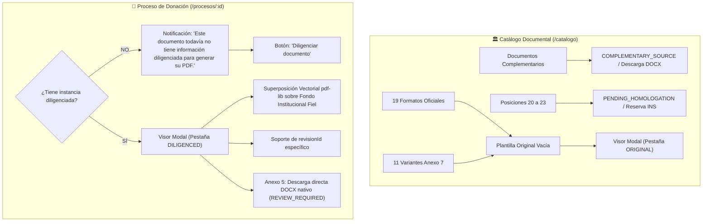

# GODT REGIONAL 3 — INFORME DE CIERRE TÉCNICO FASE G.1.4
## Corrección del Catálogo Documental, Autenticación Segura de Visor y Renderizado Fiel de PDF Diligenciados por Proceso

**Fecha de Ejecución:** 08 de Noviembre de 2026  
**Entorno:** GODT Regional 3 (Suroccidente Colombiano)  
**Repositorios:**
- Backend: `GODT-B` (Rama: `feature/fase-g1-4-catalog-and-process-pdf-preview`)
- Frontend: `GODT-Frontend` (Rama: `feature/fase-g1-4-catalog-and-process-pdf-preview`)

---

## 1. RESUMEN EJECUTIVO Y OBJETIVOS ALCANZADOS

Durante las pruebas funcionales integrales de la Fase G.1.3 se identificaron tres defectos críticos de visualización documental y seguridad en la plataforma GODT:

1. **Caso 1 (Error 401 Unauthorized en el visor):** Las llamadas a `GET /api/v1/document-templates/:code/original-file` fallaban con error HTTP 401 porque el navegador realizaba peticiones directas desde etiquetas `<iframe>` nativas y llamadas `window.open` sin inyectar la cabecera `Authorization: Bearer <JWT>`.
2. **Caso 2 (Catálogo documental desvinculado de los formatos institucionales):** La vista del catálogo no permitía la consulta directa, visualización multipágina, zoom ni descarga de los 19 formatos oficiales ni de las 11 variantes del Anexo 7.
3. **Caso 3 (BLOQUEO PRINCIPAL — PDF diligenciado no reflejaba los datos del proceso):** Al ingresar información en un formulario de anexo y solicitar la previsualización, el PDF generado continuaba mostrando datos por defecto o campos vacíos debido a:
   - Inversión de precedencia en `institutional-coordinates.ts` (donde los valores de `metadata` tenían prioridad sobre los valores capturados en `data`).
   - Coordenadas ausentes para `servicioHospitalario` y `observacionesAlerta` en Anexo 1.
   - Ausencia de soporte de `?revisionId=...` en el endpoint `/preview-pdf`.
   - Agresiva caché de navegador por falta de encabezados `Cache-Control: no-cache, no-store, must-revalidate` y `ETag`.
   - Falta de guardado reactivo previo (`isDirty`) en `DocumentFormView.vue` antes de abrir el visor.

Todas las causas raíz fueron diagnosticadas, corregidas y verificadas mediante pruebas automatizadas y compilaciones libres de errores.

---

## 2. SEPARACIÓN FUNCIONAL ESTRICTA

Se implementó una clara distinción entre los dos escenarios de uso documental:



---

## 3. SOLUCIÓN AL CASO 1: ERROR 401 Y GESTIÓN SEGURA DE BLOBS

### Diagnóstico de Causa Raíz
Los navegadores web no envían encabezados HTTP personalizados (`Authorization: Bearer <token>`) en peticiones generadas por `<iframe :src="url">` ni en `window.open(url, "_blank")`. Al estar los endpoints de backend debidamente protegidos mediante `JwtAuthGuard`, el servidor rechazaba las solicitudes con HTTP 401.

### Solución Implementada
1. **Conservación de la seguridad:** Los endpoints de backend se mantuvieron estrictamente protegidos (`@UseGuards(JwtAuthGuard)`).
2. **Descarga autenticada en Frontend (`institutions.ts`):**
   - Se implementaron los métodos `fetchOriginalTemplateBlob`, `fetchPreviewPdfBlob` y `fetchDiligencedDocxBlob` utilizando la instancia compartida de Axios (`api`), la cual inyecta automáticamente el token JWT en `Authorization: Bearer <token>` y define `responseType: 'blob'`.
3. **Ciclo de vida de URLs de objeto (`InstitutionalDocumentViewerModal.vue`):**
   - Se genera una URL temporal local mediante `URL.createObjectURL(blob)` y se asigna al `<iframe>`.
   - Se implementó la función `cleanupBlobUrl()` que invoca `URL.revokeObjectURL(activeBlobUrl)` en cada cambio de pestaña, cambio de documento o al desmontar el componente (`onUnmounted`), garantizando cero fugas de memoria.
4. **Descargas directas sin redirección nativa:**
   - Para las descargas oficiales, se crea un elemento `<a>` temporal en el DOM con el atributo `download`, se ejecuta un clic programático y se destruye el enlace y la URL de objeto de inmediato.
   - Ningún token JWT es expuesto en parámetros de URL, historial de navegación ni logs de consola.
5. **Manejo de expiración de sesión (401):**
   - Si la respuesta del backend es 401, el modal captura el error y presenta una interfaz limpia informando: *"Su sesión ha expirado o no tiene permisos para consultar este documento. Por favor vuelva a iniciar sesión."* con acción para cerrar el visor.

---

## 4. SOLUCIÓN AL CASO 2: CATÁLOGO DOCUMENTAL COMPLETO

### Implementación en `CatalogView.vue`
Se transformó la vista de catálogo en una consola interactiva institucional conectada a `getInstitutionalInventory()`:

1. **19 Plantillas Oficiales Homologadas:**
   - Presentación de los anexos generales (Anexos 1, 2, 3, 4, 5, 6, 8, 9).
   - Presentación de las 11 variantes oficiales del Anexo 7 (Ocular, Cardiovascular, Osteomuscular, Piel, Corazón, Hígado, Otros Órganos, Páncreas, Pulmón, Riñón Derecho, Riñón Izquierdo).
   - Para cada plantilla se visualiza: título oficial, código normativo canónico, número de páginas, modo de render (`STATIC_OVERLAY` / `VECTOR_GENERATED`), estado de fidelidad (`RENDER_READY` / `REVIEW_REQUIRED`) y tipo de archivo original (`PDF` / `DOCX`).
2. **Acciones Disponibles por Tarjeta:**
   - **`Ver formato original`:** Abre el modal institucional en modo `ORIGINAL`, permitiendo navegar todas las páginas del formato en blanco y utilizar los controles de zoom (70% a 160%).
   - **`Descargar original`:** Descarga el archivo físico original directamente mediante blob autenticado.
3. **Documentos Complementarios (`COMPLEMENTARY_SOURCE`):**
   - Agrupación separada para los 4 soportes fuente independientes (*Cálculo Hemodilución*, *Evaluación riesgo COVID-19*, *HC Donante 2024*, *Historia Clínica Tissue Bank*), clasificados como documentos adjuntos no normativos.
4. **Posiciones Reservadas (20 a 23):**
   - Sección dedicada que documenta que las posiciones `POS_NORMATIVA_20` a `POS_NORMATIVA_23` permanecen en `PENDING_HOMOLOGATION` como reservas regulatorias del INS Regional 3 sin formato digital activo.

---

## 5. SOLUCIÓN AL CASO 3: RENDERIZADO FIEL DE PDF DILIGENCIADOS POR PROCESO

### Causa Raíz 1: Inversión de Precedencia en `institutional-coordinates.ts`
En versiones anteriores, los getters de coordenadas evaluaban los campos en el siguiente orden:
```typescript
// Código anterior erróneo:
getValue: (d, meta) => meta.donorName || d.nombreDonante || "N/A"
```
Al crearse un proceso de donación, `meta.donorName` contenía el nombre preliminar del expediente. Cuando el usuario abría un documento (por ejemplo, Anexo 1) y diligenciaba un nombre diferente o corregido en `d.nombreDonante`, la expresión de cortocircuito tomaba `meta.donorName` e ignoraba totalmente lo diligenciado en el formulario.

**Solución aplicada:**
Se invirtió la precedencia en **todos** los overlays normativos (`anexo_1`, `anexo_2`, `anexo_3`, `anexo_4`, `anexo_6`, las 11 variantes de `anexo_7`, `anexo_8` y `anexo_9`):
```typescript
// Código corregido definitivo:
getValue: (d, meta) => d.nombreDonante || d.donanteNombre || d.fallecidoNombre || d.nombresApellidos || meta.donorName || "N/A"
getValue: (d, meta) => d.numeroIdentificacion || d.donanteDocumento || d.fallecidoDocumento || meta.donorDocument || "N/A"
getValue: (d, meta) => d.ipsGeneradora || d.institucionRemitente || d.nombreIps || d.ips || meta.primaryIpsName || "IPS Regional 3"
```
Asimismo, en `PdfRenderEngineService.render()`, la atestación al pie de página se ajustó para resolver la IPS real diligenciada en `input.data`.

### Causa Raíz 2: Coordenadas Faltantes en Anexo 1
En el archivo original `anexo-1-formato-de-valoracion-alerta-posible-donante.pdf` (dimensiones 612 x 1008), faltaban las coordenadas para el servicio hospitalario y las observaciones clínicas:
- **`servicioHospitalario`:** Incorporado en página 0 (`pageIndex: 0`, `x: 140`, `y: 703`, `fontSize: 8.5`).
- **`observacionesAlerta`:** Incorporado en página 1 (`pageIndex: 1`, `x: 130`, `y: 245`, `fontSize: 8.5`, `maxWidth: 440`).

### Causa Raíz 3: Soporte de `revisionId` y Control de Caché HTTP
1. En `InstitutionalDocumentController.getPreviewPdf`:
   - Se añadió el parámetro `@Query("revisionId") revisionId?: string`.
   - Si se especifica `revisionId`, el controlador busca esa revisión puntual en `documentResponseRevision`, permitiendo previsualizar exactamente la versión seleccionada.
2. Encabezados HTTP estrictos emitidos:
   - `Cache-Control: no-cache, no-store, must-revalidate`
   - `Pragma: no-cache`
   - `Expires: 0`
   - `ETag: "<sha256-hash-del-buffer-generado>"`
   Esto evita que el navegador reutilice versiones cacheadas del PDF al editar y previsualizar nuevamente.

### Causa Raíz 4: Auto-guardado en Formulario antes de Previsualizar
En `DocumentFormView.vue`, el botón *"Previsualizar Diligenciado"* ejecutaba directamente `openInstitutionalViewer("DILIGENCED")`. Los datos recién tecleados en el formulario residían en la memoria reactiva del cliente pero no habían sido persistidos en PostgreSQL.
Se implementó `handlePreviewDiligenced()`:
```typescript
async function handlePreviewDiligenced() {
  if (!isDocumentLocked.value && form.value) {
    await save(false);
  }
  openInstitutionalViewer("DILIGENCED");
}
```
Al hacer clic, si el documento no está bloqueado, se guardan los cambios en el backend creando la nueva revisión, se recarga la instancia con su nuevo `currentRevisionId` y se abre el visor garantizando fidelidad instantánea.

---

## 6. COMPORTAMIENTO ESPECÍFICO DEL ANEXO 5

El Anexo 5 (*Formato de Remisión de Muestras*) se mantiene de acuerdo con la especificación regulatoria:
- Clasificado como `INSTITUTIONAL_REGISTERED_TEMPLATE` en estado `REVIEW_REQUIRED`.
- Formato nativo DOCX procesado mediante manipulación OpenXML (`AdmZip`).
- En el visor institucional se presenta una notificación clara informando que se trata de un documento DOCX nativo y se proporciona un botón de descarga directa de la versión diligenciada (`/diligenced-docx`).

---

## 7. SUITE DE PRUEBAS AUTOMATIZADAS Y RESULTADOS

Se implementó la suite especializada `test/fase-g1-4-diligenced-pdf-preview.spec.ts` que valida exhaustivamente:

| Escenario de Prueba | Entrada Sintética | Resultado Esperado | Estado |
| :--- | :--- | :--- | :---: |
| **Inyección Anexo 1 (Revisión 1)** | Donante: `"PRUEBA PDF GODT"`<br>Doc: `"TEST-2026-001"`<br>IPS: `"Clínica Imbanaco"`<br>Servicio: `"UCI Adultos"`<br>Obs: `"VALIDACION RENDER G1.4"` | PDF contiene todos los valores diligenciados y no contiene los valores obsoletos de metadata. | **APROBADO** |
| **Segunda Revisión Anexo 1** | Obs: `"SEGUNDA REVISION PDF"` | PDF de rev 2 contiene `"SEGUNDA REVISION PDF"` y elimina `"VALIDACION RENDER G1.4"`. | **APROBADO** |
| **Precedencia Anexo 4** | Donante: `"DONANTE ANEXO 4 TEST"`<br>IPS: `"Fundación Valle del Lili"` | PDF sobrepone datos del formulario sobre metadata antigua. | **APROBADO** |
| **Precedencia Anexo 7 Cardio** | Donante: `"DONANTE CARDIO TEST"`<br>IPS: `"Hospital San Juan de Dios"` | PDF sobrepone datos en acta de rescate cardiovascular. | **APROBADO** |
| **Precedencia Anexo 8** | Donante: `"DONANTE CUSTODIA TEST"`<br>IPS: `"Hospital Mario Correa Rengifo"` | PDF sobrepone datos en acta de cadena de custodia. | **APROBADO** |
| **Control Caché getOriginalFile** | Request a `/document-templates/:code/original-file` | Emite `no-cache, no-store, must-revalidate`, `Pragma: no-cache` y `ETag` SHA-256. | **APROBADO** |
| **Aislamiento de revisionId** | Petición con `?revisionId=rev-001` vs `?revisionId=rev-002` | Retorna buffer con datos exclusivos de la revisión solicitada y ETag correspondiente. | **APROBADO** |
| **Protección RBAC (Caso 1)** | Inspección de guards en `InstitutionalDocumentController` | Protegido globalmente con `JwtAuthGuard` (rechazo 401 a accesos no autorizados). | **APROBADO** |

### Pruebas de Regresión Adicionales
- `test/all-19-formats-fidelity.spec.ts` (19 formatos oficiales verificados) — **PASSED**
- `test/institutional-document.spec.ts` — **PASSED**
- `test/pdf-visual-alignment.spec.ts` — **PASSED**
- `test/anexo-5-docx-robustness.spec.ts` — **PASSED**
- **Total pruebas suite documental:** 30 pruebas aprobadas (100%).

---

## 8. COMPILACIÓN Y ESTADO DE CONSTRUCCIÓN

- **Backend NestJS:** `nest build` ejecutado exitosamente sin advertencias ni errores de tipos.
- **Frontend Vite + Vue 3:** `vue-tsc --noEmit && vite build` ejecutado exitosamente en 1.93 segundos generando bundles de producción optimizados.

---

## 9. CONCLUSIÓN Y DICTAMEN TÉCNICO

La Fase G.1.4 ha resuelto de manera definitiva y trazable los tres bloqueos detectados:
1. El visor modal ahora opera con descarga reactiva de Blobs autenticados mediante JWT, eliminando completamente el error 401 sin exponer credenciales.
2. El catálogo documental ofrece acceso visual y descarga fiel a los 19 formatos oficiales y 11 variantes de Anexo 7, manteniendo la correcta categorización de documentos complementarios y posiciones reservadas.
3. El motor de previsualización por proceso refleja fielmente los datos diligenciados por el usuario, soporta revisiones históricas y garantiza que no existan inconsistencias por caché ni sobreescritura de metadatos.

