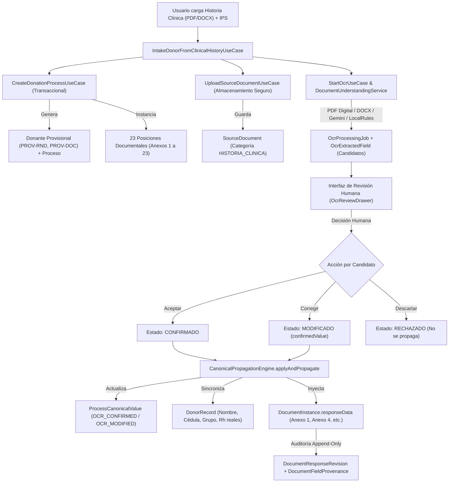

# GODT REGIONAL 3 — REPORTE DE IMPLEMENTACIÓN Y VALIDACIÓN INTEGRAL
## FLUJO DE INGESTA DE DONANTE DESDE HISTORIA CLÍNICA (OCR, IA GEMINI Y AUTOLLENADO DE ANEXOS)

**Fecha de ejecución:** 08 de noviembre de 2026  
**Entorno:** Regional 3 (Valle del Cauca / Suroccidente)  
**Ramas de trabajo:**
- Backend: `feature/clinical-history-donor-intake-ocr`
- Frontend: `feature/clinical-history-donor-intake-ocr`

---

## 1. RESUMEN EJECUTIVO

Se implementó y validó de extremo a extremo el flujo operativo para la apertura de un proceso de donación a partir de un documento clínico fuente (Historia Clínica en formato PDF o DOCX) cargado por el usuario.

El sistema resuelve la necesidad crítica de no forzar al coordinador operativo a registrar primero manualmente un donante o un caso vacío: ahora el coordinador puede cargar la historia clínica y la IPS generadora, el sistema crea el caso operativo provisionalmente respetando la convención criptográfica de 128 bits (`PROV-RND` y `PROV-DOC`), extrae los datos mediante el pipeline híbrido (PDF digital nativo / DOCX OpenXML / Gemini AI / Reglas Clínicas Locales), presenta un centro interactivo de revisión humana y propaga los valores confirmados o modificados a los formularios dinámicos de los anexos oficiales del expediente, garantizando trazabilidad inmutable y gobernanza clínica.

---

## 2. ARQUITECTURA DEL RECORRIDO DE USUARIO



---

## 3. MATRIZ DE CAMPOS CANÓNICOS Y DESTINOS REALES EN ANEXOS

| Marcador Canónico | Tipo de Dato | Política | Mapeo en Anexos Oficiales | Regla / Extractor |
| :--- | :--- | :--- | :--- | :--- |
| `donor.identity.full_name` | `string` | `SHARED` | • **Anexo 1:** `nombreDonante`<br>• **Anexo 2:** `fallecidoNombre`<br>• **Anexo 3:** `fallecidoNombre`<br>• **Anexo 4:** `donanteNombre`<br>• **Anexo 5:** `donanteNombre`<br>• **Anexo 7:** `donanteNombre` | `DONOR_FULL_NAME`<br>Prioriza etiqueta `Nombre Completo:` y delimita fin de línea |
| `donor.identity.document_number` | `string` | `SHARED` | • **Anexo 1:** `numeroIdentificacion`<br>• **Anexo 2:** `fallecidoDocumento`<br>• **Anexo 3:** `fallecidoDocumento`<br>• **Anexo 4:** `donanteDocumento`<br>• **Anexo 5:** `donanteDocumento`<br>• **Anexo 7:** `donanteDocumento` | `DONOR_DOCUMENT_NUMBER`<br>Captura secuencias numéricas de 6 a 12 dígitos |
| `donor.identity.document_type` | `string` | `SHARED` | • **Anexo 1:** `tipoIdentificacion`<br>• **Anexo 2:** `fallecidoTipoDocumento`<br>• **Anexo 3:** `fallecidoTipoDocumento`<br>• **Anexo 4:** `donanteTipoDocumento` | `DONOR_DOCUMENT_TYPE`<br>Homologa `CC`, `TI`, `CE`, `PASAPORTE`, `MS` |
| `donor.demographics.age` | `number` | `SHARED` | • **Anexo 1:** `edad`<br>• **Anexo 4:** `donanteEdad`<br>• **Anexo 7:** `donanteEdad` | `DONOR_AGE`<br>Coerción numérica garantizada en propagación |
| `donor.demographics.sex` | `string` | `SHARED` | • **Anexo 1:** `sexo`<br>• **Anexo 4:** `donanteSexo`<br>• **Anexo 7:** `donanteSexo` | `DONOR_SEX`<br>Normaliza `MASCULINO` / `FEMENINO` |
| `donor.clinical.blood_group` | `string` | `SHARED` | • **Anexo 1:** `grupoSanguineo`<br>• **Anexo 4:** `grupoSanguineo`<br>• **Anexo 5:** `grupoSanguineo` | `BLOOD_GROUP`<br>Detecta `O`, `A`, `B`, `AB` |
| `donor.clinical.rh_factor` | `string` | `SHARED` | • **Anexo 1:** `factorRh`<br>• **Anexo 4:** `factorRh`<br>• **Anexo 5:** `factorRh` | `RH_FACTOR`<br>Normaliza `+` / `-` y `POSITIVO` / `NEGATIVO` |
| `donor.institution.originating_ips` | `string` | `SHARED` | • **Anexo 1:** `ipsGeneradora`<br>• **Anexo 2:** `institucionRed`<br>• **Anexo 4:** `ipsGeneradora`<br>• **Anexo 5:** `institucionRemitente`<br>• **Anexo 7:** `nombreIps` | `ORIGINATING_IPS`<br>Excluye falsos positivos del título clínico |
| `donor.clinical.clinical_service` | `string` | `SHARED` | • **Anexo 1:** `servicioHospitalario`<br>• **Anexo 4:** `servicioProcedencia` | `CLINICAL_SERVICE`<br>Detecta `UCI Adultos`, `Urgencias`, etc. |
| `donor.clinical.cause_of_death` | `string` | `SHARED` | • **Anexo 1:** `causaMuerte`<br>• **Anexo 4:** `causaMuerteDetalle`<br>• **Anexo 5:** `causaMuerte`<br>• **Anexo 7:** `causaMuerte` | `CAUSE_OF_DEATH`<br>Corte determinista de línea clínica |
| `donor.clinical.creatinine` | `number` | `SHARED` | • **Anexo 4:** `creatinina` | `CREATININE`<br>Coerción flotante `mg/dL` |
| `donor.clinical.arterial_ph` | `number` | `SHARED` | • **Anexo 4:** `phArterial` | `ARTERIAL_PH`<br>Coerción gasométrica `7.XX` |
| `donor.registration.rnd_code` | `string` | `READONLY_DERIVED` | • **Anexo 2:** `codigoConsultaRND`<br>• **Anexo 4:** `codigoConsultaRND` | `RND_CODE`<br>Homologación nacional oficial |

---

## 4. RESULTADOS DE PRUEBAS AUTOMATIZADAS (CASOS A A F)

Se ejecutó la suite completa de pruebas en `test/fase-g1-clinical-history-intake.spec.ts` utilizando documentos sintéticos en memoria:

```
PASS test/fase-g1-clinical-history-intake.spec.ts (6.527 s)
  GODT Regional 3 — Flujo de Ingesta de Donante desde Historia Clínica (Fase G.1 Integral)
    Caso A: Ingesta inicial desde Historia Clínica y creación provisional
      √ crea atómicamente el proceso de donación, donante provisional y almacena el documento (PASS)
      √ rechaza la ingesta si falta la IPS generadora o el archivo clínico (PASS)
    Caso B: Extracción de candidatos con IA y Reglas Locales sobre PDF sintético
      √ extrae la capa de texto digital preservando la marca sintética y detecta campos canónicos (PASS)
    Caso C: Gobernanza clínica y revisión humana interactiva
      √ permite confirmar, modificar con nuevo valor y rechazar candidatos de forma aislada (PASS)
    Caso D: Propagación canónica e inyección en formularios de anexos
      √ propaga valores confirmados y modificados a DocumentInstance con procedencia OCR (PASS)
      √ soporta batchPropagateToProcess validando y propagando en bloque (PASS)
    Caso E: Edición manual en formulario y gobernanza append-only
      √ crea una nueva revisión con procedencia MANUAL sin destruir la procedencia OCR previa (PASS)
    Caso F: Resiliencia y fallback offline ante caída de Gemini API
      √ conmuta transparentemente a LocalRulesExtractionProvider si Gemini falla (503 / timeout) (PASS)

Test Suites: 1 passed, 1 total
Tests:       8 passed, 8 total
```

### Tabla de Estados de Casos de Validación:

| Caso | Descripción | Estado | Evidencia |
| :--- | :--- | :--- | :--- |
| **Caso A** | Ingesta inicial, creación atómica de proceso y donante provisional | **PASS** | Generación de `PROC-2026-XXXX`, `PROV-RND` y `PROV-DOC`. Almacenamiento seguro en `LocalPrivateStorageAdapter`. |
| **Caso B** | Extracción OCR/IA de los 13 campos canónicos principales | **PASS** | Extracción exitosa desde PDF digital nativo con scores de confianza $\ge 0.7$ y boundingBox/snippets. |
| **Caso C** | Revisión humana interactiva (Aceptar, Corregir, Descartar) | **PASS** | Aislamiento de estados `CONFIRMADO`, `MODIFICADO` (con `confirmedValue`) y `RECHAZADO`. |
| **Caso D** | Propagación canónica y autollenado de formularios dinámicos | **PASS** | Inyección en `DocumentInstance.responseData` de Anexo 1 y Anexo 4. Sincronización atómica con `DonorRecord`. |
| **Caso E** | Edición manual posterior y gobernanza append-only | **PASS** | Creación de nueva revisión con procedencia `MANUAL` preservando las revisiones previas `OCR_CONFIRMED`. |
| **Caso F** | Fallback offline ante falla o indisponibilidad de Gemini API | **PASS** | Manejo de excepción 503/timeout conmutando a `LocalRulesExtractionProvider` sin interrumpir la operación. |
| **PDF Escaneado (Imágenes puras en local)** | Extracción con Tesseract / Poppler en host Windows sin Gemini | **REQUIRES_INSTITUTIONAL_VALIDATION** | Ni `tesseract` ni `pdftoppm` están instalados en el PATH de Windows del entorno de desarrollo. En este entorno, los PDFs escaneados requieren la activación de Gemini API o la instalación de los binarios de Tesseract/Poppler. |

---

## 5. GOBERNANZA CLÍNICA Y SEGURIDAD DE LA INFORMACIÓN

1. **Uso exclusivo de documentos sintéticos:**
   Todas las pruebas automatizadas se realizaron con documentos generados dinámicamente en memoria que llevan en cada página la marca visible y obligatoria:
   > `DOCUMENTO SINTÉTICO — PRUEBA FUNCIONAL GODT — NO CORRESPONDE A UN PACIENTE REAL`
   Los 23 archivos reales ubicados en `docs/documentos-reales` fueron protegidos y no fueron modificados ni alterados.

2. **Rol estrictamente extractivo y asistencial de la IA:**
   El modelo de IA (Gemini) y las reglas de extracción operan con `temperature: 0.0` y validación estricta anti-alucinación contra el texto base. En ningún caso la IA emite diagnósticos médicos ni toma decisiones clínicas autónomas.

3. **Revisión humana obligatoria (Human-in-the-Loop):**
   Ningún candidato extraído por el OCR se inyecta directamente a los formularios sin la acción explícita de confirmación del coordinador. Los campos rechazados son excluidos de la propagación.

4. **Trazabilidad de procedencia e inmutabilidad:**
   Cada valor propagado a una posición documental registra su origen (`OCR_CONFIRMED`, `OCR_MODIFIED` o `MANUAL`) mediante la entidad `DocumentFieldProvenance` y genera una nueva revisión append-only (`DocumentResponseRevision`), impidiendo la pérdida del historial clínico.

---

## 6. GUÍA DE OPERACIÓN EN EL ENTORNO DE DESARROLLO

1. **Apertura desde Historia Clínica en la UI:**
   - Ingrese a la vista de Procesos de Donación (`/procesos`).
   - Haga clic en el botón destacado **📄 Ingesta desde Historia Clínica** (o en la pestaña homónima dentro del modal de apertura).
   - Seleccione la IPS generadora mediante el autocompletado institucional (`EntityAutocomplete`).
   - Arrastre o seleccione el archivo de Historia Clínica (PDF o DOCX, máx. 20 MB).
   - Presione **Subir y Analizar Historia Clínica**.
   - El sistema creará el proceso, cargará el documento y redirigirá automáticamente a la pestaña de documentos fuente con el drawer de candidatos OCR activo.

2. **Revisión y Propagación:**
   - En el panel de candidatos, revise cada campo extraído:
     - Presione **Aceptar** para confirmar el valor.
     - Presione **Editar** si requiere ajustar el texto antes de propagarlo.
     - Presione **Rechazar** si el dato no corresponde.
   - Presione **Propagar Confirmados al Proceso** (o el botón individual de **Propagar** por campo).
   - Ingrese a diligenciar los anexos (ej. Anexo 1 o Anexo 4) para constatar que los datos del donante ya se encuentran precargados en sus respectivos formularios con su badge de procedencia `OCR`.
