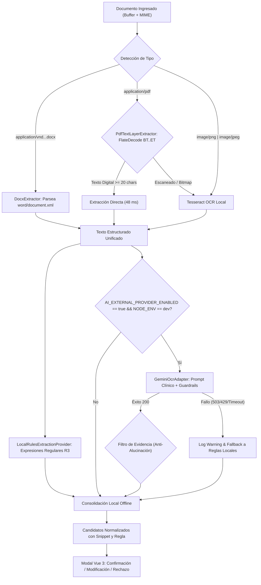

# GODT REGIONAL 3 — ESPECIFICACIÓN TÉCNICA DE OCR E INTELIGENCIA ARTIFICIAL (FASE G.1 & G.1.1)
## Motor Híbrido: Capa Digital, OpenXML, OCR Local y Google Gemini con Validación Humana

**Módulo:** Ingesta y Extracción Documental  
**Versión:** 1.1.0 (Fase G.1.1)  
**Fecha:** 2026-11-07  
**Estado:** Integrado y Validado

---

## 1. PRINCIPIOS DE ARQUITECTURA Y GOBERNANZA CLÍNICA

El subsistema de extracción documental de GODT Regional 3 implementa una arquitectura híbrida multicapa diseñada para maximizar la velocidad, la precisión y la privacidad de la información sensible del donante:

1. **Prioridad Local Determinista:** Los documentos con capa de texto digital nativa (PDFs vectoriales de historias clínicas) y archivos de procesamiento de palabras (DOCX) se procesan directamente mediante descompresión en memoria, eludiendo la rasterización a imágenes y el OCR tradicional.
2. **Gobernanza de Modelos Externos (Google Gemini API):**
   - **Variable Canónica de Activación:** `AI_EXTERNAL_PROVIDER_ENABLED` (con soporte retrocompatible para el alias `AI_PROVIDER_ENABLED`).
   - **Aislamiento por Entorno:** La invocación a Google Gemini está permitida **únicamente en `NODE_ENV=development`** (y en pruebas de humo controladas). En entornos `staging` y `production`, el proveedor externo permanece **estrictamente deshabilitado** hasta disponer del consentimiento formal y aval institucional según la Ley Estatutaria 1581 de 2012 de Colombia.
   - **Tolerancia a Fallos y Continuidad Operativa:** Si el proveedor externo no está configurado, sufre sobrecarga temporal (código HTTP 503), saturación de cuota (HTTP 429) o latencia excesiva (timeout de 30s), el sistema ejecuta un fallback automático hacia las reglas locales deterministas sin interrumpir el flujo ni descartar el procesamiento previo.
3. **Revisión Humana Obligatoria (*Human-In-The-Loop*):**
   - Ningún candidato extraído (sea por reglas locales, Tesseract o Gemini) modifica valores canónicos automáticamente.
   - Todos los campos se presentan en estado `PENDIENTE` en la interfaz Vue 3, requiriendo validación explícita (`CONFIRMAR`, `MODIFICAR` o `RECHAZAR`) por parte del coordinador asistencial.

---

## 2. ESTRATEGIAS DE EXTRACCIÓN POR TIPO DE DOCUMENTO

---

## 3. ESPECIFICACIÓN DEL PROVEEDOR EXTERNO GOOGLE GEMINI

### A. Configuración y Dependencias
- **Variable de API Key:** `GEMINI_API_KEY`.
- **Variable de Activación:** `AI_EXTERNAL_PROVIDER_ENABLED=true`.
- **Modelo Predeterminado:** `gemini-3.8-flash` (configurable vía `GEMINI_MODEL`).
- **Mecanismo de Conexión:** HTTP POST mediante `fetch` nativo de Node.js a la API v1beta de Google Generative Language con `AbortSignal.timeout(30000)`.
- **Formato de Petición:** Transmisión directa del texto plano cuando existe capa digital o base64 `inline_data` para imágenes puras.
- **Formato de Respuesta:** Array JSON estructurado bajo esquema `OcrCandidate[]`.

### B. Guardrails de Seguridad y Prevención de Alucinaciones
1. **Instrucción de Aislamiento de Contexto:** El texto del documento se inyecta estrictamente delimitado como datos no confiables de solo lectura, impidiendo técnicas de *Prompt Injection* orientadas a desviar las instrucciones del sistema.
2. **Filtro Estricto de Evidencia:** El adaptador comprueba que el valor propuesto o su `sourceSnippet` existan textualmente en el documento analizado (`input.rawText.includes(val)`). Si un valor propuesto no se encuentra en el documento, se descarta preventivamente.
3. **Prohibición de Juicio Clínico:** El sistema tiene prohibido explícitamente evaluar compatibilidad de donantes, viabilidad de órganos o causas de defunción; su labor es estrictamente transcriptiva y extractiva.
4. **Protección de Secretos:** La clave de API jamás se imprime en consola, logs de auditoría ni respuestas HTTP.

---

## 4. NORMALIZACIÓN AL DICCIONARIO CANÓNICO REGIONAL 3

Tanto las reglas locales como el adaptador Gemini normalizan los campos identificados a las claves canónicas estándar del sistema:

| Clave Canónica | Tipo | Formato / Valores Permitidos | Regla / Heurística Local |
| :--- | :---: | :--- | :--- |
| `donor.identity.document_number` | String | 6 a 12 dígitos numéricos | Cédula, CC, TI, Documento |
| `donor.identity.document_type` | Enum | `CC`, `TI`, `CE`, `PASAPORTE`, `RC` | Deducido del prefijo del documento |
| `donor.identity.full_name` | String | 2 a 4 palabras alfabéticas | Proximidad a "Donante", "Paciente" |
| `donor.clinical.blood_group` | Enum | `A`, `B`, `AB`, `O` | Grupo sanguíneo / Hemoclasificación |
| `donor.clinical.rh_factor` | Enum | `+`, `-` | Positivo (+), Negativo (-) |
| `donor.demographics.age` | Integer | 0 a 125 | Edad en años |
| `donor.demographics.sex` | Enum | `MASCULINO`, `FEMENINO` | Sexo biológico / Género clínico |
| `donor.institution.originating_ips` | String | Nombre institucional | IPS generadora, Hospital, Clínica |
| `donor.clinical.clinical_service` | String | UCI, Urgencias, Quirófano | Servicio de procedencia |
| `donor.clinical.cause_of_death` | String | Texto descriptivo | Diagnóstico de muerte encefálica / causa |
| `donor.clinical.creatinine` | Decimal | mg/dL | Creatinina sérica |
| `donor.clinical.arterial_ph` | Decimal | 6.00 a 7.90 | pH en gases arteriales |
| `donor.registration.rnd_code` | String | RND-YYYY-XXXX | Código de consulta Red Nacional de Donación |
