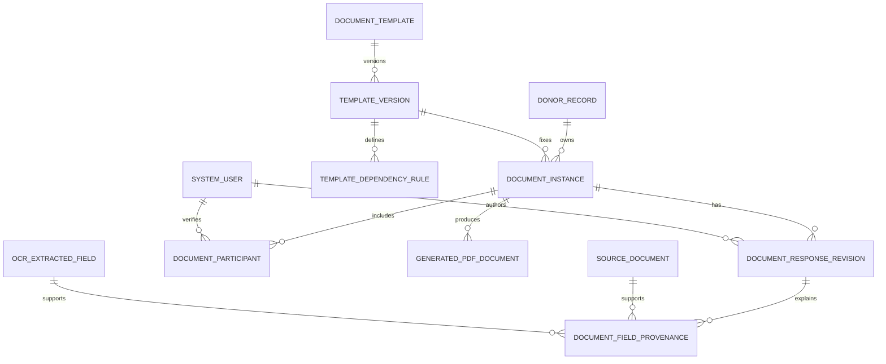

# Modelo de datos documental

## Evaluación del modelo existente

El esquema actual ya contiene `DocumentTemplate`, `TemplateVersion` y
`GeneratedPdfDocument`. `GeneratedPdfDocument` conserva `templateVersionId` y
`dataSnapshot`, lo que protege parcialmente la trazabilidad del PDF, pero no
representa borradores, revisiones, procedencia de campos ni participantes.

`SourceDocument` continúa siendo el documento fuente cargado y no debe
convertirse en una instancia diligenciada. `DonorRecord.clinicalData` tampoco
debe almacenar respuestas de formularios.

## Entidades propuestas

### DocumentTemplate

Catálogo lógico estable.

- `id` UUID PK
- `templateCode` UNIQUE, estable y no dependiente del número de anexo
- nombre, categoría, estado y metadatos administrativos
- relación 1:N con `TemplateVersion`

Desactivar el catálogo no elimina versiones ni instancias.

### TemplateVersion

Definición inmutable al publicarse.

- `id` UUID PK
- `templateId` FK
- `versionNumber` UNIQUE por plantilla
- `status`, `effectiveFrom`, `effectiveTo?`
- `jsonSchema` JSONB
- `uiSchema` JSONB
- `mappingConfig` JSONB
- `dependencyConfig` JSONB o reglas normalizadas
- `generationConfig` JSONB
- hash de definición y recursos
- autor, publicador, timestamps

El modelo actual ya contiene parte de estos campos. `authorizedBy` debe
representar autorización de publicación, no necesariamente el autor técnico.

### DocumentInstance

Agregado que representa una diligencia concreta para un donante y una versión.

- `id` UUID PK
- `donorId` FK
- `templateVersionId` FK
- `documentCodeSnapshot`
- `status`: `DRAFT`, `IN_REVIEW`, `APPROVED`, `GENERATED`, `ARCHIVED`
- `currentRevisionId` FK
- `createdById`, `updatedById`
- timestamps
- `completedAt`, `approvedAt` opcionales

Una instancia debe conservar exactamente la versión elegida. No debe cambiar
de versión porque se publique una plantilla nueva.

### DocumentResponseRevision

Historial append-only de respuestas.

- `id` UUID PK
- `documentInstanceId` FK
- `revisionNumber` UNIQUE por instancia
- `responseData` JSONB
- `validationSummary` JSONB
- `changeSummary` JSONB sin datos clínicos innecesarios
- `createdById`, `createdAt`
- `baseRevisionId?`

El borrador actual es la última revisión o una referencia a ella. Guardar
revisiones completas simplifica reconstrucción histórica; el diff puede ser
auxiliar y no debe ser la única fuente.

### DocumentFieldProvenance

Procedencia por campo y revisión.

- `id` UUID PK
- `documentResponseRevisionId` FK
- `fieldPath`
- `valueHash` y, si la política lo permite, valor serializado
- `sourceKind`: `MANUAL`, `DONOR_RECORD`, `SOURCE_DOCUMENT`,
  `OCR_CONFIRMED`, `OCR_MODIFIED`, `CALCULATED`
- `sourceEntityId?`, `sourceDocumentId?`, `ocrFieldId?`
- validador y timestamp
- estado de conflicto

No debe registrar valores OCR `PENDIENTE` o `RECHAZADO` como fuente oficial.

### GeneratedPdfDocument

Se reutiliza el modelo existente y se recomienda añadir una referencia
opcional a `documentInstanceId` y a `responseRevisionId`. Debe conservar:

- versión de plantilla;
- snapshot de datos;
- hash de definición y del PDF;
- recurso/renderizador utilizado;
- estado de aprobación;
- actor y timestamps;
- clave privada de almacenamiento.

### DocumentParticipant

Ver [document-participant-model.md](./document-participant-model.md). Relación
1:N con `DocumentInstance`.

### TemplateDependencyRule

Reglas versionadas descritas en
[document-dependency-rules.md](./document-dependency-rules.md).

## ERD propuesto

## Restricciones e índices

- UNIQUE `(templateId, versionNumber)`.
- UNIQUE `(documentInstanceId, revisionNumber)`.
- Índice `(donorId, status, updatedAt)`.
- Índice `(templateVersionId, status)`.
- Índice `(documentInstanceId, createdAt)`.
- Índice `(fieldPath, sourceKind)` solo si las consultas lo requieren.
- FK con `RESTRICT` para preservar historia.
- No `CASCADE DELETE` sobre instancias, revisiones ni PDFs.
- `DocumentInstance` debe impedir una versión no publicada salvo creación
  administrativa de borradores.
- Publicación requiere transición transaccional y auditoría.

## Respuestas parciales y estados

Guardar cualquier JSON parcial que cumpla el esquema de almacenamiento mínimo;
la validación de completitud se ejecuta al pasar a `IN_REVIEW` o `APPROVED`.
Una respuesta inválida no se pierde: queda en una revisión marcada con errores.

## Auditoría

Auditar creación, modificación, revisión, validación, aprobación, generación,
descarga y retiro. La metadata debe contener IDs, acción, versión, resultado y
correlation ID, pero no copiar contenido clínico.
