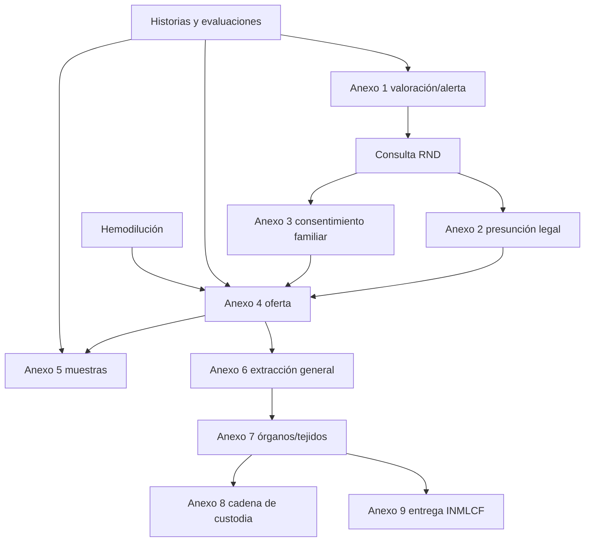

# Dependencias documentales

## Flujo funcional propuesto

## Dependencias y precargas

| Origen | Consume | Tipo de dependencia | Condición |
|---|---|---|---|
| Anexo 1 | Anexo 4 | Datos de identificación, antecedentes, laboratorios | Solo después de validar la valoración |
| Consulta RND/legalización | Anexo 2 o 3 | Selección de mecanismo | Regla institucional pendiente |
| Anexo 2/3 | Anexo 4 | Mecanismo y constancia de donación | No sustituye firmas originales |
| Anexo 4 | Anexo 5 | Identidad, grupo/RH, causa y muestras | Verificar valor de laboratorio |
| Anexo 4 | Anexo 6 | Código, tiempos y oferta anatómica | Actualizar con operación real |
| Anexo 6 | Anexo 7 | Procedimientos y responsables | Una o más variantes |
| Anexo 7 | Anexo 8 | Elementos, muestras y custodios | Cadena secuencial y no editable retroactivamente |
| Anexo 6/7 | Anexo 9 | Órganos/tejidos, instituciones y anexos | Generar solo cuando aplique proceso medicolegal |
| Historia clínica | Anexos 1, 4 y 5 | Datos clínicos y resultados | OCR solo si fue validado |
| Hemodilución | Anexo 4 / evaluación | Resultado calculado y soporte | Fórmula requiere validación institucional |

## Dependencias no automáticas

- La existencia de un documento no prueba por sí sola que sus requisitos
  clínicos o jurídicos estén completos.
- Las firmas, autorizaciones y observaciones deben conservar su origen.
- El Anexo 8 puede requerir hojas adicionales; no debe modelarse como una sola
  fila fija.
- Los documentos complementarios diligenciados son fuentes, no plantillas.
