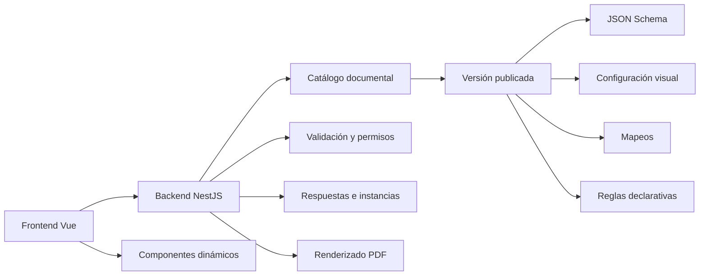

# Arquitectura del motor de formularios y documentos

## Capas



## Responsabilidades del backend

- Administrar catálogo, variantes y versiones.
- Validar JSON Schema y configuración visual antes de publicar.
- Aplicar permisos, alcance institucional y reglas de negocio.
- Resolver precargas desde expediente y OCR validado.
- Guardar borradores e instancias con la versión exacta.
- Generar PDF y conservar hash, recurso y snapshot.
- Auditar publicación, diligenciamiento, validación y generación.

## Responsabilidades de Vue

- Renderizar tipos de campo reutilizables.
- Mostrar secciones y condiciones declarativas.
- Gestionar tablas repetibles y borradores.
- Mostrar origen, confianza y conflictos.
- Ejecutar validaciones visuales, nunca sustituir al backend.
- Mostrar vista previa y estado de generación.

## Contrato de definición

Una versión publicada contiene, como mínimo:

```json
{
  "schema": { "type": "object", "properties": {} },
  "ui": { "sections": [] },
  "mappings": [],
  "dependencies": [],
  "resources": [],
  "generation": { "format": "PDF" }
}
```

Las reglas declarativas solo pueden expresar visibilidad, obligatoriedad,
catálogos y validaciones simples. No se ejecuta código almacenado en la
plantilla. Reglas clínicas, jurídicas o transaccionales permanecen en casos de
uso versionados.

## Persistencia propuesta

Reutilizar `DocumentTemplate`, `TemplateVersion` y `GeneratedPdfDocument`.
Agregar en una fase posterior, solo tras aprobación:

- `DocumentVariant` o una configuración equivalente dentro de la versión.
- `DocumentInstance` para respuestas/drafts versionados.
- `DocumentResponseRevision` si se requiere historial granular.
- Recursos visuales privados asociados a `TemplateVersion`.

No usar `clinicalData` como contenedor genérico de respuestas documentales.

## Inmutabilidad

- Una versión publicada no se actualiza.
- Una corrección crea otra versión.
- La instancia guarda `templateVersionId`, snapshot y estado.
- Un PDF histórico conserva la versión y hash utilizados.
- Los borradores antiguos no migran automáticamente.
