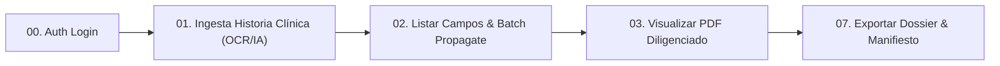

# Colección Postman — GODT Regional 3 (API REST Oficial)

Esta carpeta contiene la colección completa de Postman y el archivo de entorno actualizado para auditar y probar la API integral del sistema **GODT Regional 3**.

---

## 1. Archivos Disponibles

| Archivo | Descripción |
| :--- | :--- |
| [`GODT.postman_collection.json`](./GODT.postman_collection.json) | Colección con más de 40 endpoints organizados en 11 módulos lógicos con scripts automáticos de prueba y guardado de variables. |
| [`GODT.postman_environment.json`](./GODT.postman_environment.json) | Entorno local (`GODT - Regional 3 (Local)`) con variables dinámicas (`baseUrl`, `jwtToken`, `processId`, `donorId`, `jobId`, etc.). |

---

## 2. Instrucciones de Importación en Postman

1. Abre **Postman**.
2. Haz clic en el botón superior **Import** (o `Ctrl + O`).
3. Arrastra o selecciona ambos archivos:
   - `GODT.postman_collection.json`
   - `GODT.postman_environment.json`
4. En la esquina superior derecha de Postman, despliega el selector de entornos y selecciona:  
   **`GODT - Regional 3 (Local)`**.

---

## 3. Flujo Operativo Recomendado de Pruebas

### Paso 1: Autenticación Institucional
1. Ve a la carpeta `00. Autenticación (Auth)`.
2. Ejecuta la petición **`Login - Coordinador Operativo (Guarda jwtToken)`**.
3. El script de pruebas guardará automáticamente el token emitido en la variable `{{jwtToken}}` de tu entorno. Todas las demás peticiones de la colección heredarán este token como Bearer token de forma automática.

### Paso 2: Ingesta desde Historia Clínica (OCR mediante IA Multimodal)
1. Ve a `01. Procesos de Donación (Donation Processes)`.
2. Abre la petición **`★ INGESTA DESDE HISTORIA CLÍNICA (OCR / IA MULTIMODAL)`**.
3. En la pestaña **Body (form-data)**, haz clic en el campo `file` y selecciona cualquier archivo clínico de prueba (soporta `.pdf`, `.docx`, `.jpg`, `.png`, `.webp`, `.tif`, `.bmp` hasta 20 MB).
   - *Nota:* Puedes usar la imagen de prueba ubicada en `test/fixtures/Historia_Clinica_SURA.png`.
4. Ejecuta la petición (`POST /api/v1/donation-processes/intake-from-clinical-history`).
5. **Resultado automático:**
   - La IA Multimodal (Google Gemini) procesa los bytes de la imagen o documento.
   - Se crea atómicamente el proceso de donación, donante provisional (`PROV-RND`), documento fuente y trabajo OCR.
   - El script de pruebas almacena automáticamente en tu entorno: `{{processId}}`, `{{donorId}}`, `{{documentId}}` y `{{jobId}}`.

### Paso 3: Revisión de Candidatos OCR y Propagación en Bloque
1. Ve a `02. OCR y Extracción con IA Multimodal`.
2. Ejecuta **`Listar campos y candidatos extraídos por OCR/IA`** (`GET /api/v1/ocr/jobs/{{jobId}}/fields`) para observar los candidatos extraídos con sus scores de confianza, snippets de evidencia y metadatos.
3. Ejecuta **`★ Propagación en bloque (Batch Propagate a Process)`** para confirmar los candidatos y propagar los datos canónicos a las instancias de los anexos del proceso.

### Paso 4: Visualización de Formatos Institucionales y PDFs Diligenciados
1. Ve a `03. Catálogo y Visor Institucional (Fase G.1.3 & G.1.4)`.
2. Ejecuta **`★ Inventario técnico oficial`** para listar los 19 formatos oficiales (Anexos 1 al 19) y los 4 documentos clínicos de Regional 3 con sus hashes SHA-256 inmutables.
3. Ejecuta **`★ Visualizar formato institucional original vacío (PDF)`** para obtener el PDF del formato original intacto.
4. Ejecuta **`★ Visualizar en tiempo real PDF diligenciado de instancia`** para renderizar el formato original completado con los datos reales del proceso.

### Paso 5: Autocompletado y Búsqueda de IPS
1. Ve a `04. Instituciones e IPS (Autocompletado y Búsqueda)`.
2. Prueba las peticiones de búsqueda con queries como `Valle`, `SURA` o `Imbanaco`.

### Paso 6: Exportación Criptográfica del Expediente (Dossier)
1. Ve a `07. Expediente Documental Consolidado (Dossier)`.
2. Ejecuta **`Solicitar exportación del expediente (ZIP / PDF)`** para compilar el paquete con sellado SHA-256 por documento.
3. Ejecuta **`Descargar paquete completo del expediente (ZIP)`** o **`Visualizar PDF continuo consolidado`**.
4. Ejecuta **`Verificar integridad criptográfica del expediente`** para auditar que ningún archivo haya sufrido alteraciones.

---

## 4. Módulos de la Colección

| Módulo | Descripción |
| :--- | :--- |
| **00. Autenticación (Auth)** | Login para Coordinador y Administrador, Health check del sistema. |
| **01. Procesos de Donación** | **Ingesta OCR/IA Multimodal**, creación manual, métricas de tablero, participantes e IPS asociadas. |
| **02. OCR y Extracción con IA** | Gestión de trabajos OCR, gobernanza de candidatos y propagación en bloque. |
| **03. Catálogo y Visor Institucional** | Inventario técnico de 19 formatos, visualización de originales y renderizado de PDFs diligenciados. |
| **04. Instituciones e IPS** | Búsqueda por autocompletado y alias, registro de IPS sin duplicados. |
| **05. Diccionario Canónico** | Catálogo de marcadores, series temporales (pH, creatinina) y resolución de conflictos. |
| **06. Instancias Documentales** | Ciclo de vida de anexos, revisiones append-only y validación de esquemas. |
| **07. Expediente Consolidado (Dossier)** | Consolidación ZIP, PDF continuo, manifiesto JSON y verificación criptográfica SHA-256. |
| **08. Documentos Fuente y Soporte** | Subida y descarga de archivos de historia clínica, analíticas y documentos soporte. |
| **09. Donantes (V1)** | Gestión de expedientes clínicos individuales legados. |
| **10. Legalización** | Evaluación de mecanismos de presunción legal y consentimiento familiar. |

---

## 5. Variables de Entorno Dinámicas

| Variable | Valor Inicial / Ejemplo | Sincronización Automática |
| :--- | :--- | :--- |
| `baseUrl` | `http://localhost:3000` | Configurada manualmente. |
| `jwtToken` | `""` | Actualizada automáticamente al hacer **Login**. |
| `userEmail` | `coordinador@godt.gov.co` | Correo institucional por defecto. |
| `processId` | `""` | Actualizada automáticamente al hacer **Ingesta** o **Crear Proceso**. |
| `donorId` | `""` | Actualizada automáticamente al hacer **Ingesta** o **Crear Donante**. |
| `documentId` | `""` | Actualizada automáticamente al subir documento o hacer **Ingesta**. |
| `jobId` | `""` | Actualizada automáticamente al iniciar OCR o hacer **Ingesta**. |
| `fieldId` | `""` | Actualizada automáticamente al listar campos OCR. |
| `templateCode`| `POS_NORMATIVA_01` | Código canónico de anexo para visualización de formatos. |
| `instanceId` | `""` | Actualizada automáticamente al crear instancia de anexo. |
| `exportId` | `""` | Actualizada automáticamente al solicitar exportación del expediente. |
| `primaryIpsName`| `Hospital Universitario del Valle` | IPS de referencia para nuevas aperturas. |
| `canonicalFieldKey`| `donor.identity.full_name` | Marcador canónico para pruebas de consulta. |
